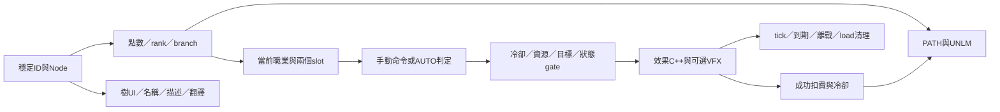

# PoTC 新增技能／能力：原始碼擴充研究

本文說明新增能力的原始碼接點、資料界線、容量與相容風險；尚未選定具體玩法或實作方案。

## 結論與版本

能在PoTC上擴充，已有技能樹、購買／退款、兩個攜帶slot、AUTO決策、冷卻、增益清理和各式效果可重用。但它目前是**編譯期C++技能系統**，不是加一份JSON／INI便會出現新技能的框架。改既有參數、加分支／被動、加獨立主動能力、擴大整棵樹，是不同範圍，應等玩法明確再選。

以 [FWM exact commit](https://github.com/fatalCMD/Fight-With-Me/tree/971b8b5aba0c34c649e70307cebdaa4aaa7bf4de) 與 [Paths exact commit](https://github.com/fatalCMD/paths-fwm-addon/tree/189f24c8a8e5b61cacfbc60b2347589c9f3eff61) 為準；所有技術位置均釘選版本，不追浮動 main。

## 導航與資料界線

16個層次的精確檔案／函式行號、資料或C++判別與驗證接點收在 [ability-map.json](ability-map.json)。欄位為layer、entry、implementation、notes、verification與固定commit source_url。具體例證見 [Arcane Surge／Elemental Burst／Healing Circle](ABILITY-EXAMPLES.md)；UI、翻譯、存檔與API細查見 [UI／save報告](ability-ui-save.md)。行號均相對釘版 FWM，Paths repo 路徑另標。

技能定義的核心是 `include/FWM/Paths.h:23,129,260,321`：Ability是可攜帶主動技能，Perk是樹節點識別，Kind又分Ability／Branch／Trait。name、glyph、tier、rank、cost、capstone雖像資料，實際是C++ constexpr；數值與描述還在 `src/Paths.cpp:134,1153,1204,1374`的switch中。一般新增技能因此需要重新編DLL。

純資料可改的是已暴露INI係數／點數設定、翻譯檔、已支援路徑的圖示／模型素材；它們不能註冊新施放邏輯。新VFX種類通常還需C++註冊、node命名契約、姿態tick及清理；新SPELL/MGEF／actor素材若不能沿用既有forms，才另評估新增ESP與FormID依賴，並非所有能力都先天需要ESP。現有IPaths API只提供進度、購買、選slot、Steering等操作，沒有RegisterAbility／RegisterNode入口（API.h:102）。

## 新增一招會跨哪些層

首先要定它是主動、分支還是被動；新增主動要新Ability與Perk，單純分支／被動通常只需要Perk。必須先決定在現有樹哪裡放：目前15格＝4×（1主動節點＋2分支）＋3被動，兩個攜帶slot。第五個主動技能需要布局、導航、Record與API容量一起變動；替換舊格則要交代原購買點、slot與舊save的轉換，不能直接覆蓋舊ID。

執行層一般可走 `Arts::Request/Update/Run`（`Arts.cpp:1747,1807,1585`）；Taunt／Heal／Rejuvenate與Specials則有歷史專用路徑，不宜照一個case推論所有技能。AUTO還要在 `AbilityPolicy::Consider` 判斷「現在有沒有用途」，由 `AbilityAuto`搜集引擎狀態；只有加入Run而沒有AUTO條件，可能手動能用、自動永遠不發動。成功才調Used並開始冷卻，不能在目標／動畫／施放失敗時消耗資源。

資源目前依role的ChoosesSpells決定魔力或耐力，三rank費用為最大值10／15／20%（`AbilityResource.h:6`、`Abilities.cpp:113`），不是任意技能各自的cost schema。新混合能力／職業若需要另種資源，須明確改這個契約。暫時buff可重用Lift／Keep／DropSource；範圍和投射物可重用純規則＋engine adapter的分層，但敵我、抗性、傷害倍率、失效目標與退出清理仍須逐招定義。

## 容量與存檔是最早的技術分岔

Ability與Perk值寫進save，均要求append-only；不能插入中間、重用retired ID或用改名字假裝不同能力。現在Ability最大ID29、count30；manual AUTO mask用uint32。下一個ID30可過現有界線；ID31仍可被mask表示，但既有 `PathsTests.cpp:43` 的count<32斷言會擋，需明確檢視／調整；ID32就不能再使用 `1u << ability`，必須擴mask、相關UI/runtime bit操作和AUTO存檔格式。這比uint8 enum的理論容量更早發生。

PATH v5以role＋Perk ID存rank，但slot保存Ability ID；正常PATH與debug前UNLM快照都須考慮。現有Repair會依新樹與點數修剪，不能視為無損遷移。只有append ID且格式不變未必需要升PATH版號；改容量、AUTO型別、退款／轉換政策則需清楚的版本與舊record測試。新DLL存過的資料再降回舊DLL，未知ID可能被丟棄。詳細位置與例子在UI／save報告。

完整FWM並用時，API v6的Record是固定7×15×2，並核tree signature；signature包含counts與節點規則。新增Ability／Perk或改樹後，不能只換PoTC DLL就期待舊FWM接受；要同定義重建兩邊，或另做明確版本化介面工程。這是技術範圍選擇，尚未決定本案要支援哪個部署組合。

## 相對成本與普通戰鬥相容

沿用既有數值或ActorValue的分支／被動相對低；新主動buff或沿用既有範圍效果為中；新命中／投射物／動畫／持續引導為中至高。真召喚NPC或擴大固定樹／雙DLL ABI為高，另有save遷移成本。這是耦合範圍判斷，不是工時估算；即使簡單buff也會受ID與樹容量門檻影響。三個例證說明各自可沿用與不能照抄之處。

若擴充同時需要保留隨從的原生普通戰鬥，應把能力的短期移動／目標／站定需求與普通配裝政策分開。純 buff 或傷害通常不需要普通配裝接管；需要引導的技能則須定義取得與撤除控制的時機，並驗證沒有 active ability 時不干預一般戰鬥。這是設計方向，不是上游已提供的註冊介面。

若新被動刻意改變武器偏好，需先定義它與「保留原生普通選裝」是否相容；可能需要拒啟、部分效果或明確選擇。手勢失敗也不應自動引入強制換手。原版角色資格、按 role 的資源政策、能力補換箭及外部 CSTY writer 都應納入個別驗證。

## 實作前待定與驗證邊界

目前只需使用者之後想清楚：新增主動／分支／被動哪種；保留原樹還是加容量；兩slot是否維持；施放目標與AUTO條件；是否需要新動畫／素材／真召喚；standalone或也支援完整FWM；舊save如何保留點數與技能。這輪不替使用者指定職業名、傷害值或點數配置，也不先建外掛註冊框架。

實作時先固定可觀察行為，再做純規則與 save round-trip、AUTO／資源正負例、效果失敗／到期／load 清理及普通戰鬥模式對照，讓故意破壞版真的被攔下。Windows DLL 編譯／PE、fresh load、UI／手把／中文顯示與自訂隨從實戰是另外的 gate；原始碼研究或 host tests 不等於新技能已可用。