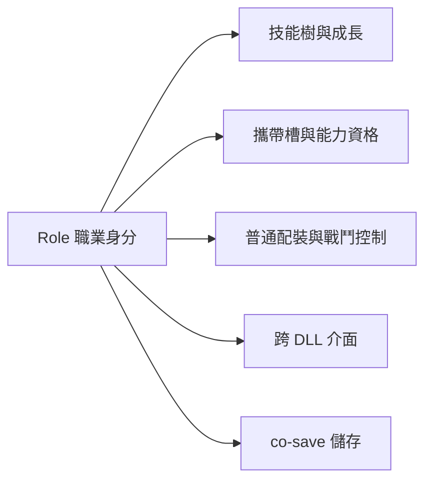

# Path of the Companions（POTC）

POTC 為隨從提供職業技能樹、點數、能力與戰鬥成長。此 finding 研究公開原始碼：Paths 1.2 `189f24c8a8e5b61cacfbc60b2347589c9f3eff61` 與共用 FWM 0.6.0 `971b8b5aba0c34c649e70307cebdaa4aaa7bf4de`；各子頁附固定 commit URL 與行號。它可以作為擴充基礎，但目前新增技能／職業主要需要修改 C++，不是加一份 INI／JSON 就能註冊。

## 先去哪裡

<!-- wf-nav -->
| 主題 | 入口 |
|---|---|
| 技能接點、資料與 C++ 界線 | [ABILITIES](ABILITIES.md)；[三個能力例證](ABILITY-EXAMPLES.md) |
| 職業、角色政策、ABI 與存檔 | [CLASSES](CLASSES.md)；[UI／文字／save](ability-ui-save.md) |
| 普通裝備接管與腳本相容 | [equipment-control](equipment-control.md) |
| 共用來源、驗證、版本與維護 | [COMPATIBILITY](COMPATIBILITY.md) |
| 技能原始碼接點資料 | [ability-map.json](ability-map.json)（16 層） |

## 目前結構與三條擴充路徑

Role 同時承擔多個責任；上游沒有獨立 PathId，也沒有任意技能的動態註冊介面。POTC 職業也不等於 Skyrim 的 CLAS record。擴充時可依需求比較以下範圍，尚未預選玩法或架構。[職業關係](CLASSES.md#結論與名詞)

| 路徑 | 適合的需求 | 主要代價 |
|---|---|---|
| 擴現有 Role 的技能 | 沿用職業，增加或改能力內容 | 技能定義／執行、UI、舊資料語意與測試 |
| 新增真正 Role | 新的可選職業與明確戰鬥政策 | 角色表、資格、成長、ABI、存檔與配對 DLL |
| 拆 PathId／Role | 成長專精與普通戰鬥職責獨立組合 | 較大架構與遷移工作，需先定語意 |

這是改動範圍比較，不是工期估算。沿用舊 ID 替換技能也可能改變已購買能力的含義；是否保留、轉換或退點，需要明確決策。

## 先知道的限制

現有樹固定 15 格、每職業四個主動技能、兩個攜帶槽。AUTO 用 32-bit mask，最大 Ability ID 為 29：下一個 ID 30 尚能沿用，ID 31 會先碰現有測試上界，ID 32 則必須改 mask 與相關存檔契約。[技能容量](ABILITIES.md#容量與存檔是最早的技術分岔)

跨 DLL API v6 固定 7 職業 × 15 節點，並驗樹內容簽章；新增 Role 會改記憶體布局，不能只在 enum 補名稱。co-save 能略過未知角色資料，但不保證降版再存後仍保留新內容。[ABI 與遷移](CLASSES.md#fwm-配對與-abi)

設計前應分清要新技能或新職業、技能需要哪些觸發與短期控制、是否依賴特定武器／法術、如何處理舊投點，以及是否支援完整 FWM 配對。原始碼研究不等於新功能已實作；離線規則測試、真正 Windows DLL 與遊戲內驗收亦是不同層次。[驗證種類](COMPATIBILITY.md#驗證種類)
