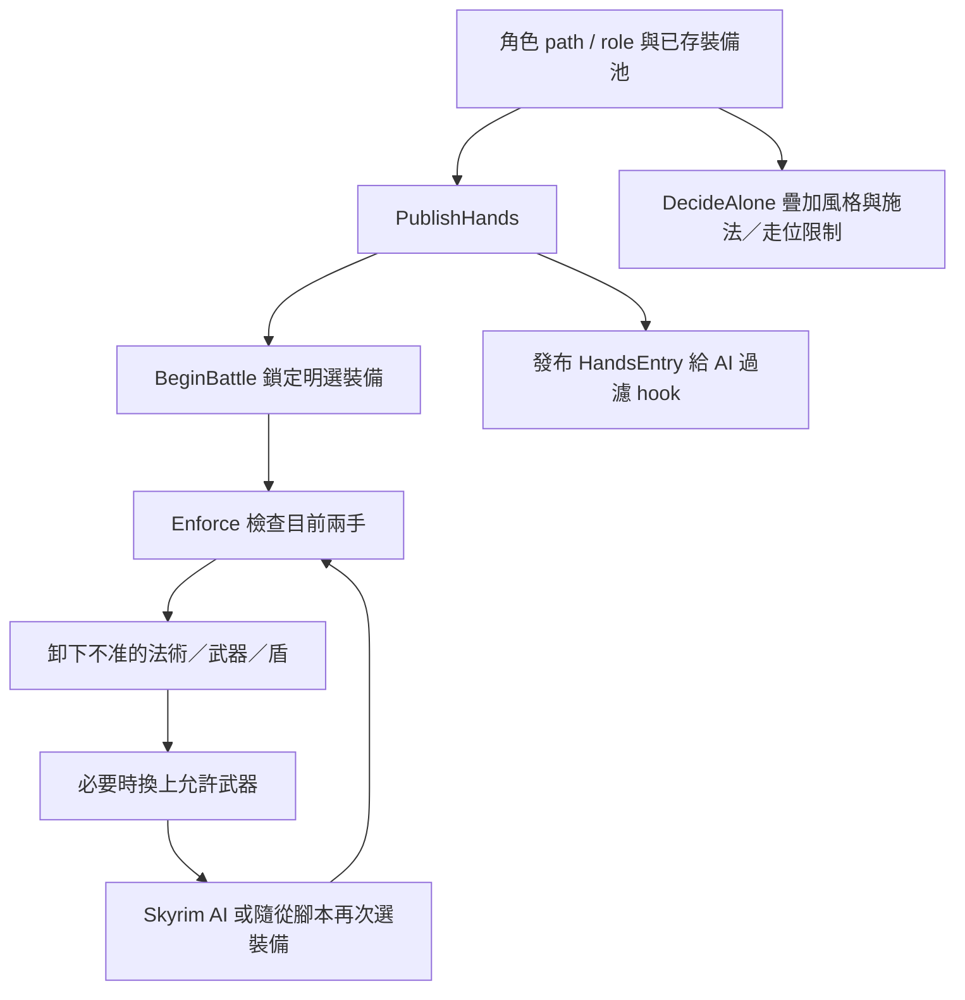

# 普通武器／法術控制與自訂隨從相容

**結論：Paths standalone 確實仍接管普通武器／法術選擇，並非只有成長與特殊技能。** 角色限制、約每秒的強制卸裝／換裝、AI 候選過濾與 combat style 疊層同時作用；自訂隨從自己的裝備腳本若要求另一套裝備，可能互相拉扯。即使沒有該類腳本，原生 AI 的施法偏好也可能與 Paths 的角色限制相反。

研究釘選 Paths 1.2 [`189f24c`](https://github.com/fatalCMD/paths-fwm-addon/tree/189f24c8a8e5b61cacfbc60b2347589c9f3eff61) 與 FWM 0.6.0 [`971b8b5`](https://github.com/fatalCMD/Fight-With-Me/tree/971b8b5aba0c34c649e70307cebdaa4aaa7bf4de)。配裝實作主要在共用 FWM core，不能只讀 addon README 的 standalone 敘述。

`Host.h:12–33` 在 Paths build 設 Abilities=true、Orders=false，但 standalone 時 `Steers()` 仍為 true。故「未安裝完整 Fight With Me」不代表普通裝備接管消失。[Host 原始碼](https://github.com/fatalCMD/Fight-With-Me/blob/971b8b5aba0c34c649e70307cebdaa4aaa7bf4de/include/FWM/Host.h#L12)

## 實際運作

`Battle.cpp:352–380` 的 PublishHands 先 BeginBattle，再 Enforce，再產生候選池與 HandsEntry；`Loadouts.cpp:205–242` 每位角色最短相隔 1000 ms 檢查，死亡、killmove 或正在攻擊時略過。無效法術／盾、角色不准的武器會 `UnequipObject`；非施法角色被卸裝後，從可用武器選傷害最高者 `EquipObject`。已有 battle lock 則直接維持鎖定選擇。[Battle](https://github.com/fatalCMD/Fight-With-Me/blob/971b8b5aba0c34c649e70307cebdaa4aaa7bf4de/src/Battle.cpp#L352)、[Loadouts](https://github.com/fatalCMD/Fight-With-Me/blob/971b8b5aba0c34c649e70307cebdaa4aaa7bf4de/src/Loadouts.cpp#L205)

**非施法角色的「空法術池」有不對稱語意。** 自動候選沒有法術時，LoadoutPolicy 將它解析為只准空手的 `{0}`，Enforce 因此可卸掉普通法術；但 PublishHands 又清空非施法角色的兩個 spell pools，Overrides 的 HandAllows 遇雙空池則放行原生選擇。於是原 AI 可再選法術、下一次 Enforce 再卸掉。這是已確認存在的機制，是否造成某位新隨從的實際症狀仍需個案證據。[LoadoutPolicy](https://github.com/fatalCMD/Fight-With-Me/blob/971b8b5aba0c34c649e70307cebdaa4aaa7bf4de/include/FWM/LoadoutPolicy.h#L57)、[Overrides](https://github.com/fatalCMD/Fight-With-Me/blob/971b8b5aba0c34c649e70307cebdaa4aaa7bf4de/src/Overrides.cpp#L185)

`DecideAlone` 仍做 magicka recovery、caster/noMelee、skills/role style 及治療圈／Volley 引導；`Styles::Apply` 會把 controller 指向疊層 style。把 styleWeight 設零或只關 `bRoleWeapons`，沒有關閉這些入口，也沒有取消前述 invalidSpell 判定。**未找到官方逐 NPC「保留成長／技能、停普通配裝」設定。** 選 Mage、指定固定武器池可讓部分角色遵循單一打法，但不等於保留角色原生劍法混用。[DecideAlone](https://github.com/fatalCMD/Fight-With-Me/blob/971b8b5aba0c34c649e70307cebdaa4aaa7bf4de/src/Battle.cpp#L1261)、[Styles](https://github.com/fatalCMD/Fight-With-Me/blob/971b8b5aba0c34c649e70307cebdaa4aaa7bf4de/src/Styles.cpp#L139)

Mage 也不是任意原生法術的通行證：Rules 只允許非 healing 法術，已學治療法術仍可能被其 pool 排除。這與是否保留已學法術是兩件事；切 role 的投點／槽位語意另見[道路切換](CLASSES.md#查看道路與切換角色)。[Rules.cpp:81–87](https://github.com/fatalCMD/Fight-With-Me/blob/971b8b5aba0c34c649e70307cebdaa4aaa7bf4de/src/Rules.cpp#L81)

## 可行方向與限制

若角色本來就要純法師或固定武器，可研究官方角色／明確 pools；這仍由 Paths 控制，不能當成原生自由選裝。若要保留隨從普通戰鬥與成長能力，則需另研究逐 NPC opt-in 的相容修補，尊重 explicit pools、battle lock 與硬裝備職業，並分開普通配裝、style 與能力暫時引導。

只修非施法角色空池卸法術，可以改善特定候選循環，但普通武器 hook、style、lock 等入口仍存在。也不能全停 Styles::Apply 又聲稱保留全部技能，因為 ShieldMaster／HeavyHands／Flanker 等靠 [Arts style tweaks](https://github.com/fatalCMD/Fight-With-Me/blob/971b8b5aba0c34c649e70307cebdaa4aaa7bf4de/src/Arts.cpp#L2132) 實現。

以上是上游機制與候選設計，沒有證明任意隨從實戰皆相容。每位角色仍須分開查原生 AI 偏好、實際裝備腳本／VMAD 綁定與檔案 winner；字串命中不等於腳本正被執行。能力需求與成長系統的擴充界線見 [相容與建構](COMPATIBILITY.md)。
