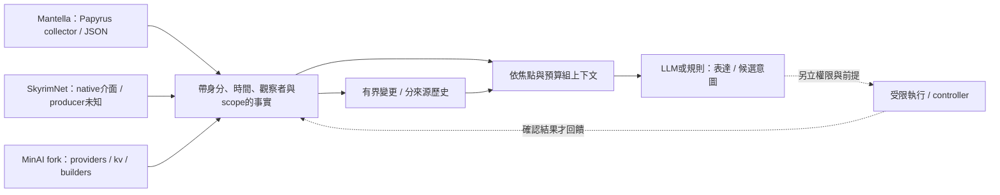

# 環境、附近 NPC、位置：如何整理成 AI 可用的世界上下文

2026-11-02 固定來源版本研究。用途同時涵蓋三套框架比較、我們的 agent 觀測補強，以及未來
ModForge／Living NPC 玩法設計；**本輪只有研究與候選方案，沒有實作、DLL、部署或遊戲驗證**。

Done when: 採集欄位、selection、刷新／cache、事實／推論、unknown／empty、prompt 取捨均有
固定來源；能分清既有能力、最小借鏡與真正缺口，不把未驗證來源寫成現役功能。

## 先看結論

核心是保留**身分、觀察者、時間與觀測範圍**，
再選出當次需要的內容。三套都能把狀態文字化，卻沒有一套可直接當成我們需要的、完整且有嚴格
freshness／unknown 語義的通用 observer。

| 系統 | 本輪能核什麼 | 主要限制 |
|---|---|---|
| Mantella | Papyrus collector→JSON→Python→prompt 完整鏈 | 詳細資料限參與者，附近只 name／distance；部分欄位沿用 cache |
| SkyrimNet | 公開 API／decorators／templates／MCP 文件 | native producer 不公開；不能核採樣／thread／cache |
| MinAI 延續 fork | Papyrus providers→actor kv→PHP builders | 官方當下不可得；fork 結論不回推原版，名稱鍵／混時鐘／missing 合流 |

Mantella 的零人省略 key 可能保留舊 targets；SkyrimNet 的 nearby 與 state summary 可混不同觀察中心；
MinAI 的 actor 參數不代表位置真以該 NPC 為中心。這些具體反例比欄位數量更影響 AI 是否說錯。
各項版本和來源在下列分篇，均是靜態研究，沒有將風險寫成本機已復現故障。

## 資料應走哪幾層

此圖是研究歸納的責任分層，不表示三套已實作相同的中介資料格式。
目前狀態、近期事件、歷史摘要、作者 bio、模擬 deeds、家具規則推論，各自保留來源；
自然語言摘要不能回寫成新的引擎真值。observed／simulated／inferred 的小例見共同語義篇。

## 閱讀路由與逐欄證據

分篇閱讀與逐欄資料入口見[分篇索引](ai-world-context/README.md)。

三份欄位資料共 **53 組**：Mantella 14、SkyrimNet 22、MinAI fork 17。
它們記錄 producer／consumer、刷新、missing／stale 語義與固定 source links，分篇有資料導航；
組數不是原始欄位數，也不是三套同等可用性的分數。

## 給我們的兩條演進路線

給開發／QA agent 的路線已有 agent-bridge。先在外部 reader 保留 raw JSON、時間區間、scope、
runtime／load epoch，再做有界差分與 deterministic renderer；不用再寫 nearby scanner。
最小驗收是截斷掉出清單不推成離場、503 不清空快照、重啟／讀檔不沿用不明基線。
真正需要 weather／NPC 活動／裝備時，才逐項補 producer 契約與家中 runtime 證據。

給正式 NPC 玩法的路線由 ModForge authoring、production observer、context builder 與既有
Living controller 分工；不能要求 QA harness 常駐玩家 load order。
先做一種場景短評或一次確證事件反應，再考慮 favor 影響一個 off-screen anchor 分支。
不用一開始導入全套對話、TTS、向量記憶或自由 actions；AI 輸出只能落在作者允許、執行前重查的範圍。

兩條路可以共用資料語義。公司 WSL 可驗 reader／renderer 的合成例、未知值和重送規則；
真採集、NPC 目擊、PEX／語音、save/reload、招募 ownership 與效能仍須家中。
Living 的使用者界線維持「回家看 FDE Janessa 後再決定」，本研究不重開暫緩工作。

## 與舊答案的分工

[四框架對 ModForge 的既有借鏡](ai-frameworks-modforge-relevance.md)仍談 authoring／整合方向；
三套舊拆解保留對話與 actions 概覽。本 topic 補的是逐欄採集、觀測邊界、時間與缺值契約，
並校正本輪能重核的過度確定說法，不將新 fork 行為倒推成舊官方版本的歷史事實。
與 `mojibake-dev/chim` 插件／存檔工具的獨立研究無關。
