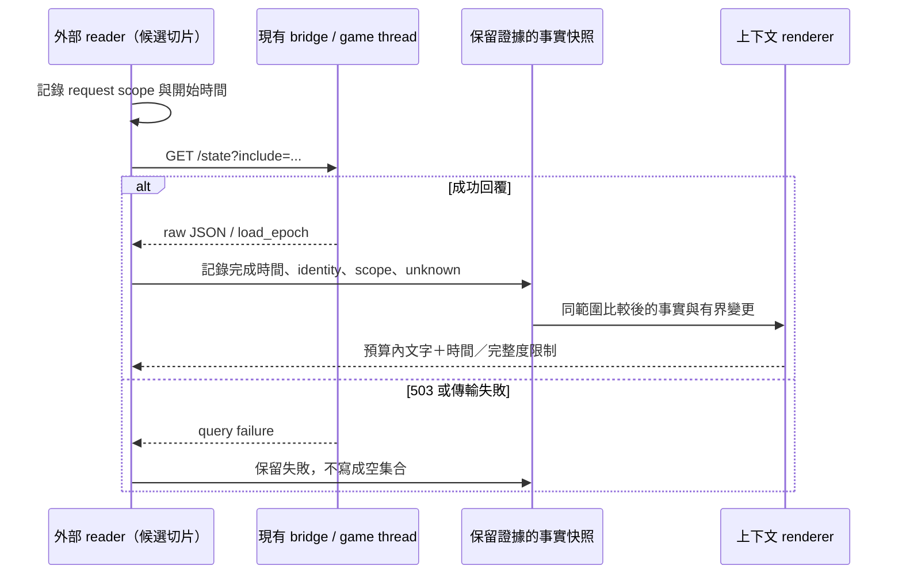

# 從引擎讀值到 AI 上下文：應保留的語義

[返回入口](../ai-world-context.md)｜[bridge 對照](bridge-fit.md)

本篇是依三套來源歸納的設計判斷，不宣告新的 API 或已完成框架。
具體反例與版本證據見 [Mantella](mantella.md)、[SkyrimNet](skyrimnet.md)、[MinAI](minai.md)。

## 「知道附近發生什麼」其實有三種資料

引擎讀到 `IsInCombat`、actor reference、cell、position，是該次讀取的狀態；家具名稱含 forge
而產生「正在磨劍」是規則推論；角色 bio、LLM scene summary、歷史對話摘要則是 authored／generated
內容。三者可以一起給 AI，但不能互相覆蓋來源身分。尤其「名字」「技能」「任務知識」可由資料庫提供，
並不表示 NPC 當下已觀察到它。

SkyrimNet 的家具字串規則是低成本描述的案例，也暴露翻譯名稱、家具同名與「坐在某處」不等於
「正在從事該工作」的限制。MinAI 的位置 fallback 則會從 cell 中 reference 或腳下物件取得名稱；
它可提高描述可讀性，卻不是 Location hierarchy 的直接觀測。Mantella 的 relationship trust
會混合遊戲 relationship rank 與交談次數，也不等於純引擎關係數值。

## 快照要能回答：誰、何時、從哪個範圍看到

對 actor 用 runtime reference 身分對齊；名稱留作顯示，base ID 只表示藍圖。
多名 guards、同 base 的隨機 NPC、玩家重新讀檔，都可能讓名稱或 base ID 不夠唯一。
跨行程或不同 load order 的耐久識別還需要 plugin/local ID 與 save/load 身分，不能假設單一數字永遠有效。

觀察者、範圍、半徑、是否只限 loaded/high-process、LOS/FOV、排序／上限，同樣是事實的一部分。
「玩家中心 4096 units 內 high-process actors」與「某 NPC 周圍可互動 targets」不是同一份世界。
SkyrimNet 的 sourceEntity 周邊表與 player 中心 state summary 提醒我們：prompt 組合時仍可能混用視角。

現在的 bridge reader 可先記錄 actor identity、原始回應、request 開始／完成時間、查詢參數、
`load_epoch` 與已知限制。精確 producer timestamp、完整度、總筆數尚未提供的地方必須保留 unknown。
這些是資訊完整性的最小需求，不代表先建一個全域 event store。

下例是**合成的研究提案，非已實作 API**。T0 是讀值時間，T1 是組包時間；unknown 的欄位
不能因為包在 T1 生成就變成 T1 的新讀值。`source` 保留可追溯的採集／模擬依據。

```json
{
  "generated_at": "T1",
  "observer": "player",
  "scope": {"kind": "high_process", "radius_game_units": 4096},
  "facts": [
    {"subject_ref": "0x01001234", "field": "in_combat", "status": "value",
     "value": false, "kind": "observed", "observed_at": "T0", "source": "bridge/state"},
    {"subject_ref": "0x01001234", "field": "equipment", "status": "unavailable",
     "reason": "not_collected", "observed_at": null, "source": "bridge/state"},
    {"subject_ref": "0x01001234", "field": "deeds", "status": "value",
     "value": 3, "kind": "simulated", "observed_at": "T0", "source": "living/timer"}
  ]
}
```

家具名稱→活動另記 `kind: inferred` 和規則／依據；成功讀取的合法空槽用 `empty`，
不附「正在徒手攻擊」推論。模型摘要也保留 `generated` 身分，不能混進 `observed`。

## 新鮮度有多個時鐘

wall-clock／monotonic elapsed 適合 request timeout、採樣間隔和 TTL；遊戲時間適合晝夜、
「昨晚」與世界經過多久；load/process identity 適合判斷快取能否沿用。三種時鐘不要互換。
MinAI 同時存在 real-time 更新排程與 game-time 節流；Mantella 按對話交互刷新，不是連續 observer；
SkyrimNet native collector 的採樣時鐘未公開，不能從 template 呼叫推定每次都是即時引擎讀取。

一次 render 可能同時包含本次引擎旗標、上次 cache、幾分鐘前 event、較久以前的摘要。
自然語言都寫成現在式會掩蓋這個差異。最小做法是將「當前讀值」「近期事件」「歷史記憶」分段，
讓摘要保留來源與時間範圍；不能把 summary 的句子反灌成新的 engine fact。

## 空、沒收到、不可讀與過期不同

成功掃描後空集合，才可以清除同範圍的舊集合；key 未送可能是未請求、producer 沒更新或不支援。
讀取前提不成立屬 unavailable；request 失敗不是一份合法空快照。Mantella 已出現省略 nearby key
而保留舊 target cache 的實際路徑；MinAI 部分 location 值在更新失敗時保留上值。

對外 renderer 可顯示「最後觀測於……，本次不可讀」，而不是靜默沿用現在式。
若來源無法區別真正空和讀不到，應保留「完整度未知」，不能由 consumer 自行補成確定不存在。
bridge 的 actor-diagnostics 契約已把 `value / empty / unavailable` 和 query failure 分開，
可延用這個語義，不必再發明第二組空值規則。



## 先選內容，再壓縮文字

完整 actor blob 不等於好 context。Mantella 將對話參與者詳細資訊與 nearby targets 分離；
SkyrimNet 有 target／short render modes、近期事件過濾；MinAI 按模組與頻率更新。
可借的共同點是先決定焦點和相關性，再渲染。

優先保留焦點 NPC、直接交互對象、戰鬥／任務相關變更；附近其他角色可以只留 identity、距離與
已知旗標。裁切後標明省略或完整度未知，避免 LLM 把未列出誤當不存在。
固定欄位與規則文字通常先用 deterministic renderer；長期對話記憶才考慮 LLM 摘要，且原始事件可追溯。
不能因為 token 不夠，就丟掉錯誤狀態、觀測者或時間，留下看似確定的結論。

## 觀測不自動授予執行權

讀 context、生成 AI 意圖、執行遊戲動作是三個邊界。Mantella 與 SkyrimNet 的成品包含 actions，
但研究它們的 collector 不需要一起導入 TTS、對話接管、package 操作或 console。
對日後玩法，先讓 AI 產生可驗證的候選意圖，再由既有執行能力、白名單、當下前提和明確結果決定能否執行。
本輪只建立可比較的研究證據；執行器、NPC 玩法與授權模型尚待獨立決定。
