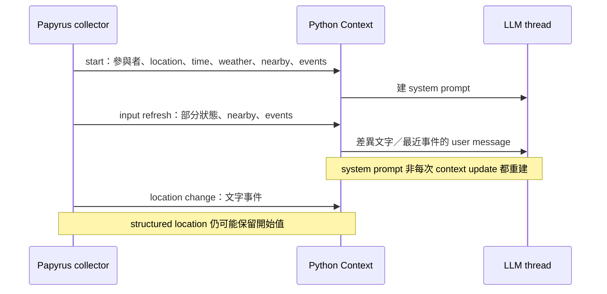

# Mantella：對話中的局部資料包，不是完整世界查詢器

[返回入口](../ai-world-context.md)｜[欄位矩陣](mantella-fields.json)

基線：官方 Python `c0c1ae6db01f3c2a14dbab8ec5c3e6419e4f6bac`（2026-07-16）與
Mantella-Spell `0c5f8513aff61cda1f32c81a962eee36ba74fdb7`（2026-07-11）。
均為 main HEAD，非本機版本。矩陣 14 組，欄位為 scope、wire_field、
collector、refresh、prompt_transform、missing_stale_semantics、status、source_link。

## 採集鏈

Papyrus 以 `buildActorSetting`／`BuildContext` 讀取狀態，SKSE_HTTP typed dictionaries 序列化
成 JSON，再 POST `/mantella`；Python parser 合併 Context／Characters，填 system prompt，
並把動態事件放下一則 user message。native HTTP 不是世界採集器本身。
[Spell collector:965–1105](https://github.com/art-from-the-machine/Mantella-Spell/blob/0c5f8513aff61cda1f32c81a962eee36ba74fdb7/Scripts/Source/MantellaConversation.psc#L965-L1105)、
[Python parser:282–327](https://github.com/art-from-the-machine/Mantella/blob/c0c1ae6db01f3c2a14dbab8ec5c3e6419e4f6bac/src/game_manager.py#L282-L327)

Participants 欄位有 base/ref ID、名稱、性別、種族、是否玩家、對玩家關係、
voice type、combat、enemy、equipment、custom values。`is_enemy` 實際是 combat target 是否玩家，
不能擴成所有敵對關係。加入／移除成員時重建；普通輸入只按設定更新 `is_in_combat`，
不保證 relationship／enemy／equipment 同步。Python 既有 Character 更新也不換 equipment。
[collector:982–1011](https://github.com/art-from-the-machine/Mantella-Spell/blob/0c5f8513aff61cda1f32c81a962eee36ba74fdb7/Scripts/Source/MantellaConversation.psc#L982-L1011)、
[Character merge:39–53](https://github.com/art-from-the-machine/Mantella/blob/c0c1ae6db01f3c2a14dbab8ec5c3e6419e4f6bac/src/characters_manager.py#L39-L53)

非參與者是另一條輕量路徑：啟動 quest → 讀最多 5 個 closest loaded-area aliases → 停止 quest。
條件排玩家、死者、conversation faction，未見 radius 或 LOS。只傳 `name,distance`，距離由
玩家到 actor 的 game units 除 71.0210 轉 meter；沒有 reference ID、裝備或活動。
不可套用自發對話的 radiant distance。
[scan:263–286](https://github.com/art-from-the-machine/Mantella-Spell/blob/0c5f8513aff61cda1f32c81a962eee36ba74fdb7/Scripts/Source/MantellaListenerScript.psc#L263-L286)、
[quest conditions:7–154](https://github.com/art-from-the-machine/Mantella-Spell/blob/0c5f8513aff61cda1f32c81a962eee36ba74fdb7/Spriggit_data/Quests/MantellaNearbyActors%20-%2021414C_Mantella.esp.yaml#L7-L154)

## 更新時序和 stale 值

開始對話呼叫 `BuildContext(true)`；mic／player input 需要更新時再採。text path 在開輸入框
**之前**採，送出時重用；action continue path 只取新事件。沒有每 frame observer。
[start:78–108](https://github.com/art-from-the-machine/Mantella-Spell/blob/0c5f8513aff61cda1f32c81a962eee36ba74fdb7/Scripts/Source/MantellaConversation.psc#L78-L108)、
[text:534–560](https://github.com/art-from-the-machine/Mantella-Spell/blob/0c5f8513aff61cda1f32c81a962eee36ba74fdb7/Scripts/Source/MantellaConversation.psc#L534-L560)

location 只在 start 送 `GetCurrentLocation().GetName()`，空名 fallback Skyrim。
OnLocationChange 加文字事件而不更新該 key。hour 依 toggle 刷新，gamedays 每次 BuildContext 更新；
weather 僅戶外依 toggle 送，Python CSV 查表再 fallback classification，室內省略時保留前值。
同一包混有本次值與 cache，沒有共同採集時間／generation ID。
[BuildContext:1028–1112](https://github.com/art-from-the-machine/Mantella-Spell/blob/0c5f8513aff61cda1f32c81a962eee36ba74fdb7/Scripts/Source/MantellaConversation.psc#L1028-L1112)、
[location event:479–489](https://github.com/art-from-the-machine/Mantella-Spell/blob/0c5f8513aff61cda1f32c81a962eee36ba74fdb7/Scripts/Source/MantellaListenerScript.psc#L479-L489)

附近零人時 Spell 省略 key；Python 缺 key→None→不更新 nearby cache，故先有人後無人可能留下舊 targets。
外部明送 `[]` 可清 cache，但不產生「現在無人」事件，也不清 previous name set。
nearby event 只比較 name 集合，距離／排序／同名角色替換不一定有新提示。
這是靜態推導，未實機重現。
[Context:216–238](https://github.com/art-from-the-machine/Mantella/blob/c0c1ae6db01f3c2a14dbab8ec5c3e6419e4f6bac/src/conversation/context.py#L216-L238)、
[nearby cache:100–104](https://github.com/art-from-the-machine/Mantella/blob/c0c1ae6db01f3c2a14dbab8ec5c3e6419e4f6bac/src/characters_manager.py#L100-L104)

## 事件、摘要與 token 取捨

玩家／參與者 alias 收 item、spell、hit、equip、sit、death 等事件；不是所有附近角色都有相同 listener。
事件是無 timestamp／ID 的文字 array；BuildContext 先 copy 再 clear，HTTP error 清理對話，
未見 ack／replay 保證。不能從來源推定可靠 event log。
[queue:766–778](https://github.com/art-from-the-machine/Mantella-Spell/blob/0c5f8513aff61cda1f32c81a962eee36ba74fdb7/Scripts/Source/MantellaConversation.psc#L766-L778)

system prompt 填場景、角色、裝備、靜態 CSV bio 與歷史對話記憶；不是反覆塞完整 raw JSON。
system budget 45% 依序嘗試「bio＋memory」「只有 bio」「兩者都無」，仍太長只 warning；
全 thread 到 90% reload，從最近對話保留約 10% 預算。當次事件只留最後 N 條，預設 5，
沒有重要性排序或通用語意摘要，nearby 提示也可能被擠掉。
[prompt budget:416–521](https://github.com/art-from-the-machine/Mantella/blob/c0c1ae6db01f3c2a14dbab8ec5c3e6419e4f6bac/src/conversation/context.py#L416-L521)、
[event selection:374–388](https://github.com/art-from-the-machine/Mantella/blob/c0c1ae6db01f3c2a14dbab8ec5c3e6419e4f6bac/src/conversation/conversation.py#L374-L388)

trust 同時用 relationship rank 與過往交談次數；bio 是作者資料，summary 是 LLM 產物，
enemy 文字還附可能成因。它們都是詮釋／記憶，不等於本次觀測。
`vision_hints_*` 有 consumer，但此 Spell collector 未找到 producer，不能宣稱標準包已有 LOS。
[trust:301–329](https://github.com/art-from-the-machine/Mantella/blob/c0c1ae6db01f3c2a14dbab8ec5c3e6419e4f6bac/src/conversation/context.py#L301-L329)、
[vision consumer:106–124](https://github.com/art-from-the-machine/Mantella/blob/c0c1ae6db01f3c2a14dbab8ec5c3e6419e4f6bac/src/conversation/context.py#L106-L124)

## 身分與執行邊界

backend active characters 以 name 作 key，附近 targets 也按 name 解析；同名參與者有加數字措施，
附近者仍用原 display name。Python 會截去一般 FormID 的 load-order 高位，未保留完整 plugin identity；
不能當跨 plugin／save／動態 spawn 的耐久鍵。
[ID normalization:330–343](https://github.com/art-from-the-machine/Mantella/blob/c0c1ae6db01f3c2a14dbab8ec5c3e6419e4f6bac/src/game_manager.py#L330-L343)

conversation start 會分配 alias／faction，nearby scan 也啟停 quest；整套產品不是無副作用的 reader。
actions 以 ModEvent 交 handler，附近 cache 亦可能成為 action targets。
可借「詳細參與者＋輕量周邊」「結構化事實＋文字事件」「目前 context＋歷史記憶」分層；
獨立觀測器須另定 ID、empty／unknown、freshness，無需一併導入 actions／TTS。
[action dispatch:639–717](https://github.com/art-from-the-machine/Mantella-Spell/blob/0c5f8513aff61cda1f32c81a962eee36ba74fdb7/Scripts/Source/MantellaConversation.psc#L639-L717)
