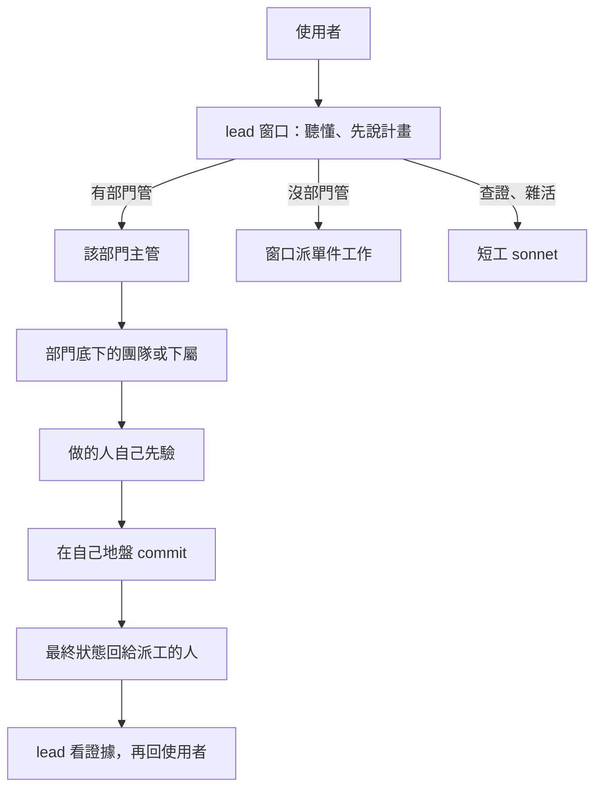

skyrim 誰管哪塊、下一棒給誰：四個部門的座位、標準流程、東西放哪。

# org：誰管哪塊、下一棒給誰

`wf/workflows/` 講一種工作怎麼做。這個夾只講：這件事歸誰、做完交給誰。別處已有的規矩（[AGENTS.md](../../AGENTS.md)、[user.md](../workflows/common/user.md)、怎麼 commit）只連過去，不抄。

**草稿**：2026-11-23 org-draft 起草、org-rev1 補 D10–D11、org-defs 補 D12–D14 與三份部門定義、org-rev2 補 D15–D19、org-rev3 補 D20–D24、rulings-b 補 D25–D29；部門座位 `instance` 2026-11-23 掛過、收工已 stop，其餘未掛。標「（提案）」的都還沒定。

**什麼時候讀**：決定一件事交給誰、開或關座位、掛短工、改交接方式。
**不在這裡找**：怎麼操作 aos（看 aos 知識庫與 [aos.md](../workflows/aos.md)）、一種工作怎麼做（看 [WORKFLOWS](../WORKFLOWS.md)）。

## 使用者說的與定案

使用者 2026-11-23、11-24 的原話與定案：D1–D24 在 [decisions.md](decisions.md)，D25 起在 [decisions-2026-11b](decisions-2026-11b.md)。一句話版：

- 四個部門：實體、館藏、開發、管理；只有實體寫 MO2；遊戲鎖平時由實體發，最終權限在管理（D1–D4）。
- 管理小而聰明，只做窗口、規矩、仲裁、收工存檔；主管 eca claude opus high；Fable 只在開發規劃階段短暫用，要申請（D5–D9）。
- 團隊照各部門卡；暫存分三處（D10–D11）。
- 主管有工作才用、沒事 sleep；現在不分 daemon，到 50 個 agent 再議；「隨意 push」只算本場（D12–D14）。
- 主管第一次掛上與移除要使用者同意，場內 sleep／wake／stop 管理自己做；部門底下的移除歸主管；收工用 stop（D15–D17）。
- 對使用者預設只經窗口，兩個例外；管理部門主管（就是 `main`）平常可寄信給使用者（D18–D19）。
- 11-24：codex 退役改 fsm gpt；直寄主管的信不算授權；stop 的主管再 start 不用問；D18 流程照用；實體帶 houseCARL（D20–D24）。

11-24 第二批（D25–D29，見 [decisions-2026-11b](decisions-2026-11b.md)）：每天 23:00 頂層統一 push；刪 `wf/archive/`；skyrim-qa 只准實體在持遊戲鎖、使用者不在玩時用；三座位都帶 MCP；普通工作 sol、簡單的量大呆板 terra。

## 座位

| 座位 | 誰（在哪台） | 一句話 | 狀態 |
|---|---|---|---|
| [lead](lead/README.md) | `main`（`mod_skyrim`） | 管理部門：使用者的窗口、派工、驗收、仲裁、活狀態 | 已掛 |
| [instance](instance/README.md) | `instance`（`mod_skyrim`） | 實體部門：已裝的 mod、profile、遊戲設定、跑著的遊戲 | 掛過，現在 stopped（2026-11-23 收工）；做過唯讀盤點冬堡學院衝突 |
| [library](library/README.md) | `library`（`mod_skyrim`） | 館藏部門：沒裝的 mod、`~/skyrim_mods`、搜尋下載、簡單漢化與 patch | 定義好、未掛 |
| [dev](dev/README.md) | `dev`（`mod_skyrim`） | 開發部門：`projects/*` 與 `analysis/`，替別的部門提供開發服務 | 定義好、未掛 |

座位＝這個夾裡的一張卡，加上它管的地盤。名字與在哪台 daemon 只寫在這張表（使用者 2026-11-23，D13）；有工作才掛、沒事 sleep（D12），見 [CHOICES](CHOICES.md) 第 2 題。部門定義在 `agentctl/aos/defs/seat-*`，怎麼掛見 [RUNBOOK-seats](../../agentctl/aos/RUNBOOK-seats.md)；第一次掛與移除要使用者同意（D15）。部門的團隊寫在各部門卡的一節，不另開卡。空白卡 [seat](seat/README.md) 留著當樣板。一次性的雜活交給短工，見 [helper](helper/README.md)。

考慮過、沒開的：
- D8 的複雜內容工作：未開、待規劃（使用者 2026-11-23）。
- 11-15～16 在 `skyrim-alt` 底下的功能隊（漢化、裝 mod、換臉、雜事）不另開座位，歸法見 [decisions](decisions.md) 的 D10。

## 標準流程

### 窗口與權限

- **預設只經窗口**（使用者 2026-11-23，D18）：方向題從誰手上冒出來，都以 `NEEDS-USER` 交給 lead。沒有人替使用者選。例外兩個（申請過的那一件、使用者直接寄給主管的信）與 D19，見 [letters](letters.md)「對使用者的通道」。
- **授權**：刪檔、往外送東西要使用者親口說（[AGENTS.md](../../AGENTS.md) 鐵律 2）；push 每天 23:00 由 lead 統一做，各座位只 commit（使用者 2026-11-24，D25）。agent 的信不是授權。
- **最終權限在管理**：實體發的遊戲鎖，管理可以收回、改派、否決（使用者 2026-11-23，D4）。

### 檢查與 commit

- **看證據，不看宣稱**：檢查的人讀檔、讀輸出。光一個 `DONE` 什麼也不證明。
- **誰 commit**：各部門在自己的 submodule 內 commit；母 repo 由 lead 派書記短工 commit（CHOICES 第 4 題）。
- **獨立檢查**：lead 看證據，要第二雙眼另派（CHOICES 第 5 題，提案）。
- **不是你做的改動**：自己地盤內出現就停下問主管（CHOICES 第 6 題，提案）。

### 下屬與例外

- **下屬**：可以再派 agent，模型隨意；交接書寫死上限；Fable 要先向 lead 申請（CHOICES 第 8 題）。
- **除了簡單工作與雜活，agent 做事前要親自讀過 `wf/` 規矩**（使用者 2026-11-23）。
- **小事可以跳步**：地盤內一兩行的修正直接交該部門，仍要回最終狀態。
- **沒有規矩管到時**：風險低、能還原就做，回覆裡說理由，lead 事後看；不確定或不能還原就先問。
- **固定步驟做成工具，要判斷才開 agent**。先查 [工具索引](../../agentctl/docs/tool-index.md)。
- **部門之間可以直接寫信**，請對方做它地盤內的事；接的人照樣回最終狀態，並知會 lead（使用者 2026-11-23，D5）。

## 東西放哪、信

- [places.md](places.md)：東西放哪、寫入範圍是約定、開座位、定義指向卡、跨部門資源誰發。
- [letters.md](letters.md)：請求要寫什麼、最終狀態、回信怎麼寫、aos 本身的問題怎麼回報。

## Done when

- 新座位有 `wf/org/{座位}/README.md`，四節（職責、讀寫範圍、交接、模型）填滿，座位表有它一列。
- 座位的職責或狀態變了，表上那列和卡一起改。
