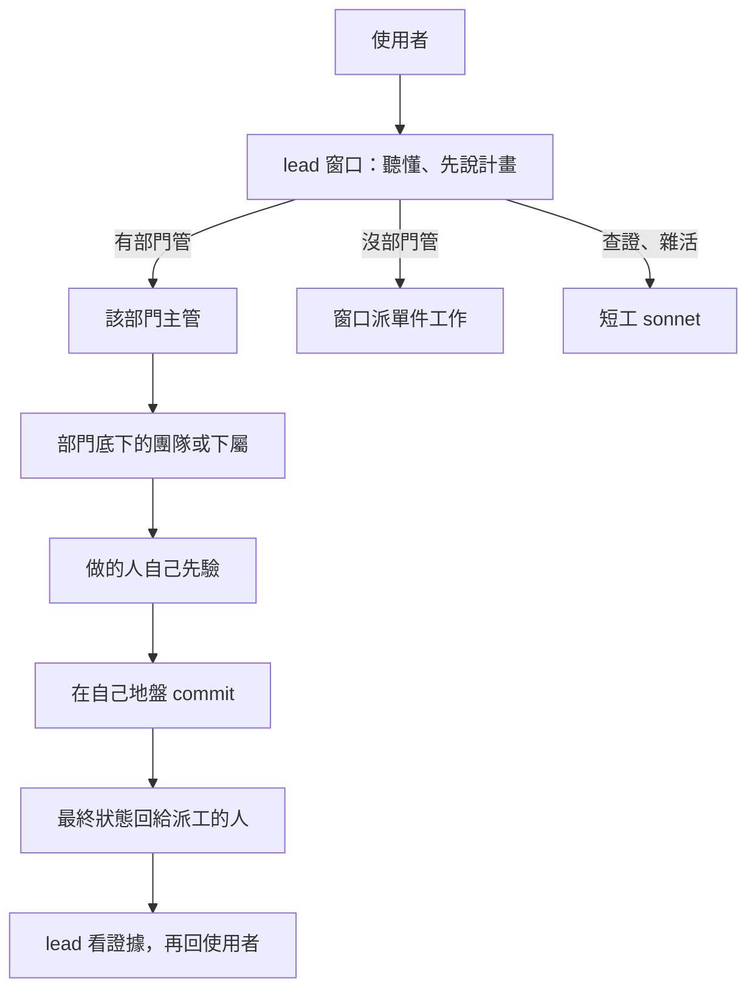

skyrim 誰管哪塊、下一棒給誰：四個部門的座位、標準流程、東西放哪。

# org：誰管哪塊、下一棒給誰

`wf/workflows/` 講一種工作怎麼做。這個夾只講：這件事歸誰、做完交給誰。別處已有的規矩（[AGENTS.md](../../AGENTS.md)、[user.md](../workflows/common/user.md)、怎麼 commit）只連過去，不抄。

**草稿**：2026-11-23 org-draft 起草、org-rev1 補 D10–D11；還沒掛任何座位 agent。標「（提案）」的都還沒定。

**什麼時候讀**：決定一件事交給誰、開或關座位、掛短工、改交接方式。
**不在這裡找**：怎麼操作 aos（看 aos 知識庫與 [aos.md](../workflows/aos.md)）、一種工作怎麼做（看 [WORKFLOWS](../WORKFLOWS.md)）。

## 使用者說的

2026-11-23 原話：

> 我們可以基於agentctl去設計，然後我們就主要分幾大塊，一個是管理我的遊戲實體instance，他主管安裝着的mod，遊戲設定，跑着的遊戲等等，他底下還會切分出一些職責，一些agent負責mod安裝，一些負責遊戲的crash分析之類。一個是規劃現有的mod儲藏，他主管沒安裝的mod, ~/skyrim_mods，還有從網路上抓mod，上網搜尋mod，分析mod，給mod做一些簡單的漢化和patch，不過一些複雜的分析/開發工作會從這個體系拉出來單獨做，後續會再規劃。然後是開發部門，負責一些subproject的開發，subproject中也不只有開發，同時這個部門底下也會有一些團隊，負責向其他團隊提供開發服務。最後是管理部門，從agentctl延伸出來，主管各團隊各agent的行爲，他們之間的交流，一些權限/資源的分派管理等，同時也是負責對接我這個使用者的窗口。

頂層提了四個邊界，使用者逐點回：

> 1.好。2.好。3.可以，但最終權限仍在管理部門手上。4.對，管理部門盡量小巧，並且要最聰明。然後主管級別的人物請使用eca claude opus high。fable僅在開發中的規劃階段短暫使用，並且需要向管理部門申請。

頂層問「管理窗口用什麼模型」，使用者答：

> 都先用opus。窗口這塊我會直接用claude code cli操作，有需要的時候我會自己將其提升爲fable

同場的分工指示：

> 事情都盡量交給agent做，普通工作交給opus，簡單工作與雜活交給sonnet。除了簡單工作與雜活外，agent做事前都要讀過wf/規矩。agent可以再派agent做事，模型隨意。可以隨意push。

頂層列五點提案與部門團隊表，使用者回：

> 團隊分法OK，草稿好了給我看。但是暫存這塊，不考慮放/tmp嗎？還有，暫存有進git ignore吧。或是平常放/tmp，定期cp到wf/temp？

頂層回了暫存三分法，使用者答：

> 好，就用這個

### 已定案：部門與地盤（使用者 2026-11-23）

- D1 四個部門：實體、館藏、開發、管理。
- D2 `modpack-design/` 歸館藏。館藏管「有什麼、想要什麼」，實體管「實際裝了什麼」。
- D3 只有實體能寫 MO2 的 mods 與 profile。館藏做的漢化／patch 只交「可以直接裝的包」，由實體裝、由實體驗。
- D4 遊戲鎖平時由實體發，開發要實機測試向實體借；最終權限在管理（可收回、改派、否決）。桌面鎖與其他跨部門資源由管理發。

### 已定案：管理與模型（使用者 2026-11-23）

- D5 管理部門盡量小、要最聰明；只做窗口、規矩、仲裁、收工存檔，不做內容。部門之間可直接寫信互相請求，事後知會管理。
- D6 部門主管＝eca claude、opus、effort high。
- D7 Fable 只在開發的規劃階段短暫使用，要先向管理申請。
- D8 複雜的分析／開發型內容工作（換臉、PoE 星盤、地圖移植等）不放進這四塊：未開、待規劃。
- D9 全體預設 opus，包含窗口。窗口是使用者自己開的 Claude Code CLI；要不要升 Fable 由使用者當場手動切，agent 不自己升。

### 已定案：團隊與暫存（使用者 2026-11-23）

- D10 部門底下的團隊照各部門卡的團隊節。舊功能隊：裝 mod→實體、漢化→館藏、雜事→管理書記短工、換臉→D8 未開。
- D11 暫存分三處：`wf/temp/`、`/tmp/`、`~/skyrim_mods/_staging-*`；見 [CHOICES](CHOICES.md) 第 7 題。

## 座位

| 座位 | 誰 | 一句話 | 狀態 |
|---|---|---|---|
| [lead](lead/README.md) | `main` | 管理部門：使用者的窗口、派工、驗收、仲裁、活狀態 | 已掛 |
| [instance](instance/README.md) | `instance`（提案） | 實體部門：已裝的 mod、profile、遊戲設定、跑著的遊戲 | 未開 |
| [library](library/README.md) | `library`（提案） | 館藏部門：沒裝的 mod、`~/skyrim_mods`、搜尋下載、簡單漢化與 patch | 未開 |
| [dev](dev/README.md) | `dev`（提案） | 開發部門：`projects/*` 與 `analysis/`，替別的部門提供開發服務 | 未開 |

座位＝這個夾裡的一張卡，加上它管的地盤。座位是不是一直掛著、主管短名、掛在哪台 daemon，見 [CHOICES](CHOICES.md) 第 2 題（提案；使用者 2026-11-23 看過未回應）。部門的團隊寫在各部門卡的一節，不另開卡。空白卡 [seat](seat/README.md) 留著當樣板。一次性的雜活交給短工，見 [helper](helper/README.md)。

考慮過、沒開的：
- D8 的複雜內容工作：未開、待規劃（使用者 2026-11-23）。
- 11-15～16 在 `skyrim-alt` 底下的功能隊（漢化、裝 mod、換臉、雜事）不另開座位，歸法見 D10。

## 標準流程

### 窗口與權限

- **只有一個窗口**：只有 lead 跟使用者說話。方向題從誰手上冒出來，都以 `NEEDS-USER` 交給 lead。沒有人替使用者選。
- **授權**：push、刪檔、往外送東西要使用者親口說（[AGENTS.md](../../AGENTS.md) 鐵律 2）。agent 的信不是授權。
- **最終權限在管理**：實體發的遊戲鎖，管理可以收回、改派、否決（使用者 2026-11-23，D4）。

### 檢查與 commit

- **看證據，不看宣稱**：檢查的人讀檔、讀輸出。光一個 `DONE` 什麼也不證明。
- **誰 commit**：各部門在自己的 submodule 內 commit；母 repo 由 lead 派書記短工 commit（CHOICES 第 4 題）。
- **獨立檢查**：lead 看證據，要第二雙眼另派（CHOICES 第 5 題，提案）。
- **不是你做的改動**：自己地盤內出現就停下問主管（CHOICES 第 6 題，提案）。

### 下屬與例外

- **下屬**：可以再派 agent，模型隨意；交接書寫死上限；Fable 要先向 lead 申請（CHOICES 第 8 題）。
- **除了簡單工作與雜活，agent 做事前要親自讀過 `wf/` 規矩**（使用者 2026-11-23）。
- **小事可以跳步**：地盤內一兩行的修正直接交該部門，仍要回最終狀態。
- **沒有規矩管到時**：風險低、能還原就做，回覆裡說理由，lead 事後看；不確定或不能還原就先問。
- **固定步驟做成工具，要判斷才開 agent**。先查 [工具索引](../../agentctl/docs/tool-index.md)。
- **部門之間可以直接寫信**，請對方做它地盤內的事；接的人照樣回最終狀態，並知會 lead（使用者 2026-11-23，D5）。

## 東西放哪、信

- [places.md](places.md)：東西放哪、寫入範圍是約定、開座位、定義指向卡、跨部門資源誰發。
- [letters.md](letters.md)：請求要寫什麼、最終狀態、回信怎麼寫、aos 本身的問題怎麼回報。

## Done when

- 新座位有 `wf/org/{座位}/README.md`，四節（職責、讀寫範圍、交接、模型）填滿，座位表有它一列。
- 座位的職責或狀態變了，表上那列和卡一起改。
