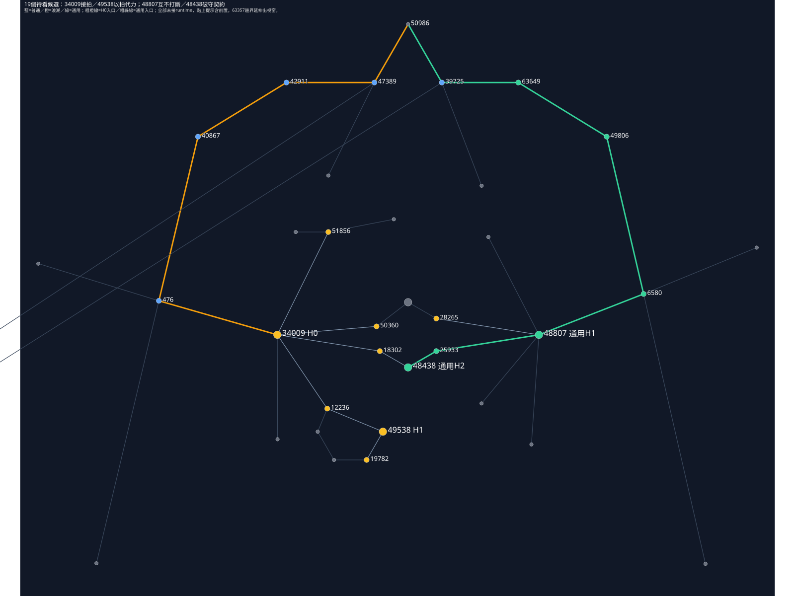

# 近衛・浪潮鬥士：先打一拍，再決定如何接

名字取你說的「一浪接一浪」。

這次是**近衛通用池＋浪潮鬥士單型**的新設計稿。你照用原本的普通攻擊、重擊與格擋，不另學招式、不選互斥職業。近衛通用池不需要浪潮鬥士；浪潮高階先開新機制，後續進階再依它生效。**尚未接runtime，19點全部是待看候選**，不把術師程式的離線通過算到這一型。

## 實際怎麼打

普攻命中A，建立這次接拍機會。下一次你可以再普攻A收傷害與回耐，換打B放棄收拍並弱化A，或擋住A的一次武器攻擊，換下一擊的保護。這些是同一份機會的分支，不會每條一起白拿。

若選「以拍代力」，打法再改：必須先普攻命中取得機會，才可以開重擊；重擊以這份機會代替原生耐力成本。但啟動後就押下去了，揮空、取消也失去機會。你會重視命中窗口、距離與是否值得冒一次重擊，而不只是耐力夠就連按。

[單獨開圖](../workflows/plans/poe-skyrim-mapping/combat-combinators/double-beat-sample/region.svg)。19個候選＝15個原normal＋4個原notable，原ID、座標、連線、類型不改；notable不改成keystone。邊界63357原位置很遠，線仍保留而延伸出視窗。

H0入口是 `50986→47389→42911→40867→476→34009`，四個中間點都是普通，不會先要求買接拍進階才到H0。通用池另有 `50986→39725→63649→49806→6580→48807→25933→48438`，不依接拍H0。某些浪潮點可從通用區走到，所以**圖連通與規則前置必須同時成立**，不能繞路就略過34009。

## 浪潮路線的兩個高階

**34009・接拍（獨特）**：原生普通近戰命中敵人後，取得本人唯一的「前一拍目標＋期限」機會；首擊只建立，不能同次當第二拍。H0本身不送額外傷害、回耐或其他進階。建立及後續分支都重查存活、非本人且對owner敵對的Actor；箱桶／自傷／友方誤擊不建、不刷、不兌現，也不額外清掉仍合法的舊拍。接拍短窗T待審，不是全局疊層cap；換敵、同敵、重擊與格擋按已購規則決定下一步。

**49538・以拍代力（獨特，需34009）**：原生重擊必須以接拍機會支付，取代本次原生重擊SP付款；沒有機會就不能開重擊。啟動被接受時即消機會，揮空或取消也不退。收益是把「先普攻賺到的機會」變重擊資源；代價是失去自由開場、連續重擊。設計希望有機會時可零SP啟動，但原生啟動門檻與付款交易仍待驗，不能說已做成。

## 六個接拍進階

以下六點都需**34009接拍**。n=1數字只是本輪試案，未採用；也不會附送另一套接拍載具。

**12236・雙拍切口（獨特）**：下一個原生普通攻擊命中前拍同敵、沒有被擋，該次原生武器傷害×1.15，消機會。不是命中後額外補扣HP。

**18302・斷架重擊（獨特）**：重擊命中前拍同敵，額外削敵SP＝本人最終最大SP的5%。若「以拍代力」已在啟動時消了機會，仍用該次鎖定的前拍目標判同敵；打到別敵不能冒領。這個SP比例是新試案，不是術師MP比例裁示的延伸批准。

**28265・換鋒脫困（獨特）**：前拍是A，下一次普攻改打B，放棄A的收拍，令A對本人的輸出÷1.15，示範3秒；同owner對同敵重得只替換強度、刷新期限，不乘疊，只影響該敵對本人的這一路。B這一下只照原傷，不同時拿同敵第二拍收益，也不自動給B新機會。

**50360・轉守留步（共享候選）**：前拍A後，真正擋到A的原生武器接觸，消機會換一次守步：下一筆確有正HP傷提交的敵向原生近戰武器傷害÷1.20；法術、箭矢、DoT、環境、自傷不算。每owner一份，重得替換強度並刷新有限T_guard（秒數待調），不加次數；同生成交易、完全0傷都不吞。成功用一次、到期、死亡／離戰、Reset／load即清。這是一次性狀態形狀，不是全局數值cap。

**19782・二拍回息（共享候選）**：成功普通第二拍同敵後，回本人最大SP的2%。可與雙拍切口同次收益，但接拍只消一次；重擊、換敵與轉守不領這筆。

**51856・破擋再接（獨特候選）**：同敵普通第二拍被擋時，**自動另付本人最大SP的5%**（本點n=1；成本公式為5%÷本規則有效份數n），可保留原機會到原到期時間。付不起就失去機會；不延壽、不算成功二拍、不給切口／回息。你是在買一次重試或改招的餘地。

同敵成功普通第二拍只有「切口＋回息」可同路；重擊、換敵、轉守、被擋保留不能順便領它們。普通揮空不刷新機會；「以拍代力」的重擊啟動承諾則更嚴格。目標死亡、owner死亡／離戰、武器切換或到期要清，不能把舊目標機會無限帶走。

## 近衛通用池：不需要接拍

**48807・互不打斷（高階）**：本人近戰武器攻擊不再造成stagger，本人也不受敵人近戰武器stagger。你能把近戰攻勢做完，但失去靠硬直解圍的手段；法術、箭矢控制與HP/SP傷照常，不是免控。

**48438・破守契約（高階）**：本人近戰攻擊不可被格擋，本人也不能格擋。你可直接處理持盾敵，卻必須靠走位、距離與護甲承壓；不是必中或無視護甲。敵人仍可擋其他人。

**63649・蓄力有餘（進階）**：命中前本人SP至少75%，本次原生近戰傷害+10%。保耐穩傷，或花耐追擊。

**49806・穩架承壓（進階）**：本人這次真正格擋到敵人的原生武器接觸，且事件前SP至少50%，格擋後的合格傷害再÷1.10。不是完美格擋。

**6580・弱敵壓制（進階）**：敵HP不高於25%時，本次原生近戰stagger係數+10%。不是固定暈眩／中斷，入口尚待驗。

**25933・卸力回息（進階）**：本次真格擋且能證明原生SP實扣，返該筆20%。不拿理論cost或damage反推退款，也不返超實扣。

「互不打斷」會禁止弱敵壓制的stagger；「破守契約」會讓穩架、卸力、轉守與破擋再接沒有觸發。兩個通用高階可同選，代價也一起承擔，不是要你全買。

## 普通底盤與範本邊界

五個普通點沿已定單份：47389生命+5、42911耐力+5、40867生命+5、476耐力回復+10%、39725護甲+6AR。目前每A原normal一份，所以展示n=1；High的weight3不是三份機會或三次免耐，DBA6多份只降低額外續拍成本，不增加次數或期限。規則點是替換原節點效果的候選，不保留原GGG數值後再附送新能力。

通用池4進階／2高階另計；浪潮6進階（4獨特候選）／2獨特高階。獨特是與同職業的浴血／藏鋒玩法比較，不是禁止你混搭或新增職業鎖；兄弟兩型這次不一起填。

原生hit通知可分power／bash／blocked與weapon base，卻沒有一次揮擊ID、實傷或左右手實例；同一揮擊多hit不能冒充兩次攻擊。傷害修改、成功啟動、格擋SP實扣、零SP重擊與揮空消機會都需另驗。這次只交真圖設計，不把觀察事件當取消原生傷害／付款的能力。[資料與規則正本](../workflows/plans/poe-skyrim-mapping/combat-combinators/double-beat-sample/README.md)。
