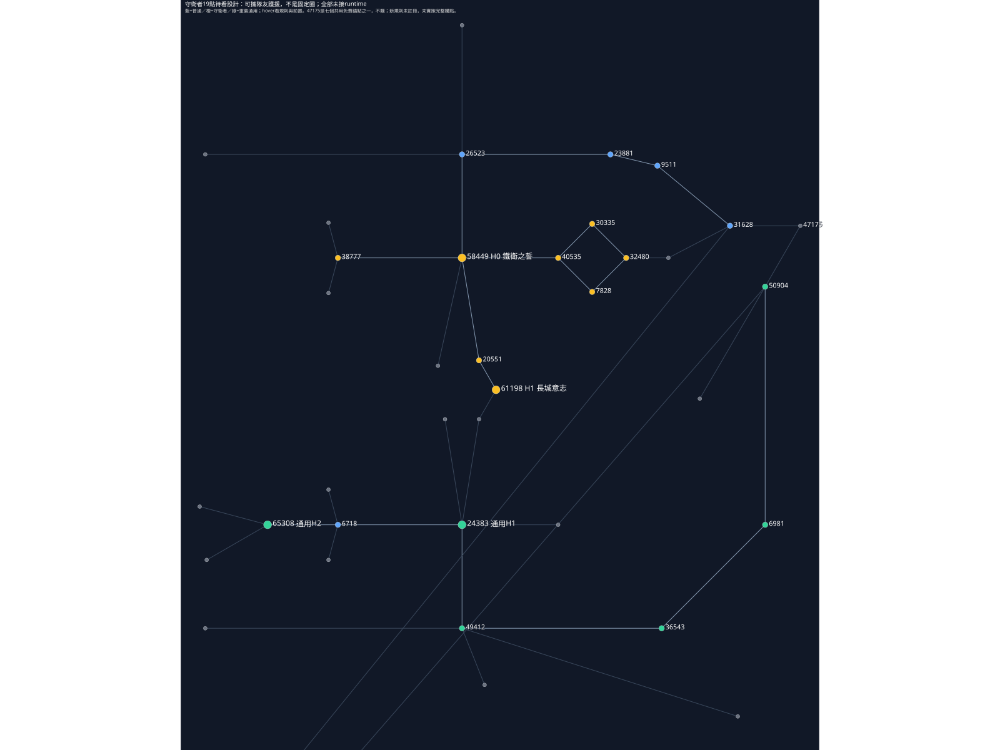

# 重裝・守衛者：把護援交給隊友帶著走

依你的修正，**不以固定陣／隨身圈當主玩法**。你用原生盾或武器真正格擋，替一名隊友上限時護援；隊友拿到後跑開也保留，不要求混戰中一直站你旁邊。這是19個真節點的設計候選，runtime=0，不是已可玩的技能，也不要求另外學勇氣術。

## 先看怎麼玩

你靠近想保護的同伴A，真格擋一次授A護援。A追遠程跑走仍帶著它；你下一次真格擋可給近處尚未持本人護援的B。A真的受敵近戰壓力時，援護可減傷、緩衝，並反壓實際攻擊者的耐力。你再選繼續格擋補援，或撤掉自己的外送防護，換反擊／回耐。

若選「長城意志」，隊友在原期限內可多次受護，但你必須維持格擋、放棄普通／重擊／bash；一放盾先撤自己的全部護援，再恢復進攻。是護隊伍與親自解題的取捨，不是永久全隊光環。

[單獨開圖](../workflows/plans/poe-skyrim-mapping/combat-combinators/warden-sample/region.svg)。19候選＝15原normal＋4原notable，不改ID／座標／邊／類型，避開既有術師17與浪潮19點。原圖Marauder47175是既有程序七個共用免費錨點之一，起點不購、不計19；新規則未註冊，尚未實跑完整購點順序。H0設計路是 `47175→31628→9511→23881→26523→58449`，四普通先到高階。通用另有 `47175→50904→6981→36543→49412→24383→6718→65308`，不依鐵衛之誓。

## 守衛者的兩個高階

**58449・鐵衛之誓（獨特）**：真格擋一次，從當下同戰鬥場景、R_apply內且可見的合法存活隊友，優先選最近尚無本人護援的他者。若全都有，只刷新本人最早到期的一份；一格擋一人，不全隊重刷、不讀AI仇恨或自動挑最低血。沒人就不發，也不改給自己。R_apply與T_aid待調，距離只管派發，授予後走開不撤。

H0本身只開護援狀態與下游入口，不白送A減傷。普通護援在原生格擋／護甲後仍有正HP待扣的合格近戰交易消一次：即使護援最後把它抵到0，也用掉。新授不能回頭擋生成它的同一交易。每giver＋recipient一份，重授只刷新；giver死亡／離戰／Reset／load、recipient死亡／非法或到期才清。

**61198・長城意志（獨特，需58449）**：護援不再挨一次就消，而在各自原期限內持續作用；代價是施者必須持續原生格擋，期間不能普攻／重擊／bash。放下盾或解除格擋時，先撤本人全部護援才可進攻。舉盾、移動不延長期限；要續仍須真格擋按H0派一人。撤援只撤自己的，不抹其他守衛者的份。

## 六個護援進階

以下都需58449；本區每A一份，展示n=1。新倍率／比例均試案，High的weight3不是三次援護或三倍效果。

**38777・磐石之軀（共享候選）**：受援者合格敵向近戰待扣HP傷÷1.10；不含箭、法術、DoT、環境與自傷。普通援護用一次；繫盾則原期限內每筆適用。

**40535・城垣壁障（共享候選）**：同一交易在厚盾後再抵10HP，不倒補血。厚盾與緩衝可同筆，但普通護援只消一次；不是減到0就可以無限留著。

**7828・逆鋒制敵（獨特）**：受援隊友發生合格護援受擊交易，額外削實際近戰攻擊者SP＝giver最終maxSP的3%。不要求你本人被打，不反彈HP、不改AI。普通援護本筆消；繫盾可每個可去重原生交易一次，不能由削耐再造新hit。

**30335・摧軍反攻（獨特）**：本人有有效外送護援時，原生近戰bash命中敵，撤掉本人全部援護，使本次原生bash失衡係數×1.50。原bash成本照付，未命中不撤，不保證暈眩；代價是隊友現在失去你的防護。

**32480・戰意回湧（獨特）**：本人原生重擊命中，撤全部本人有效護援，依它們的平均剩餘時間比例回耐：`本人maxSP×2%×n×平均(剩時/原期限)`。人多不翻倍，沒有效援護不回、揮空不撤不發；不是退原生重擊實付，也不能再拿bash收益。

**20551・軍心振奮（共享候選）**：H0新授某人一份護援時，只該人恢復自己maxSP的2%。刷新既有本人護援不發；舊份確已消耗／失效後的新授才算。繫盾延持、移動、單純舉盾都不算新授，不自動全隊回耐。

繫盾期間放盾先清援護，故摧軍反攻／回息沒有收益，不能把兩條當持盾必買。與浪潮「互不打斷」同配時，禁止失衡優先，摧軍反攻分支停用，不因一次普通bash白撤護援；bash本身原生傷害照常。這是設計相容性，尚無UI阻擋購點。

## 重裝通用池：不需要鐵衛之誓

**24383・耐力護體（高階，純規則）**：本人真格擋，原生block SP費先付；本次原生格擋／護甲及防護後的殘HP傷，再先由剩SP按1HP↔1SP承擔，不足才扣HP。保命會吃掉反攻／移動資本，不是先受傷再補血。例：付完原生費剩SP12、殘HP傷20，再付SP12，只受HP8。

**65308・厚甲薄力（高階，極端純數值交換）**：最終maxHP×2、maxSP×0.25，皆試案；不改MP，不是即時回血或復活。血量容錯高，格擋／重擊／衝刺耐力卻很脆。與耐力護體同選，薄SP仍會很快耗光；也會降低新授逆鋒制敵的SP基準，不能讀base假裝沒有代價。

**50904・穩架承壓（進階）**：本人真格擋存活敵人的原生近戰WEAP，排箭／法術／bash／自傷；同交易前SP至少50%，格擋／護甲後HP傷÷1.10。與浪潮GCA2是同canonical；混買合份n，只判一次條件、除一次，不疊第二倍率。

**6981・危局節力（進階）**：交易前本人HP低於35%，本次原生近戰格擋SP成本÷1.15。只省原生格擋費，不省後面耐力護體的HP轉SP付款，不先按理論值發退款。

**36543・擋重破勢（進階）**：真格擋敵原生重擊時，額外削攻擊者SP＝本人最終maxSP的3%。只認可證接觸，排bash／箭／法術；不叫完美格擋。

**49412・疲守保命（進階）**：交易前SP低於25%，本人受合格敵近戰HP傷÷1.10，不強制這次已格擋。不恢復耐力；與穩架的高耐條件用同一初始快照，不兩頭拿。

## 合份、普通與來源

多giver可各有護援，但同類效果先合係數只結算一次：厚盾÷(1+0.10Σn)、緩衝抵Σ10n，反壓SP也先合量只扣一次；普通lease各消一次，繫盾lease保留。這是暫態來源合併，不把其他人的份數寫成受援者星盤點，也不能撤／回收別人的援護。

五普通沿真atom單份：31628 HP+5、9511 SP+5、23881 AR+6、26523 SP回復+10%、6718 HP+5。通用4A2H另計，守衛6A中3unique、2H unique；原notable仍weight3，機制預算未核，沒有保留原GGG數值後再附送能力。

參考已讀合併幻術樹Second Wind／Hold The Line／Arise的隊友buff描述，但描述不證完整效果鏈或現役winning。真FWM Rally Fire的Abilities::Lift與Skald Fervor顯示「授予時選人、TTL內離距保留」模式；不等於新格擋→援護橋已接，也不強加Courage施法。既有Party程式不含所有召喚物，合法友軍／可見性／giver租約與受傷交易仍待實作。全部compiled/runtime=false；[規則與真圖資料](../workflows/plans/poe-skyrim-mapping/combat-combinators/warden-sample/README.md)。
