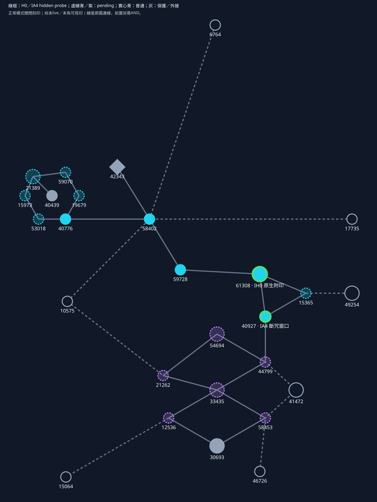

# 刻印 先解鎖高階再讓原生法術附印

本輪依你的新裁示實作隔離候選：**附印本身是高階能力，買了才有刻印進階資格。** 不再每個進階附送一套印，也不是另外學一招印記法術。你照用已有法術；附印、歸因與後續效果由買點啟用的被動橋處理。source／公司離線驗證在進行，尚非live功能。

公司現已重建隔離1.2.4 source候選，baseline及兩項審閱修正已通過公司離線驗證，施法來源→購點規則→附印→削魔的跨模組整合測試也已通過。**正常模式仍關閉刻印能力**；明確實驗模式只探測「原生附印→斷咒窗口」，限瞬發、單效果、單手、效果範圍欄為0的敵向傷害法術；不代表所有原版法術都接好了。印目前沒有可見特效，沒有新Windows DLL或遊戲驗收。

## 先走到核心

[單獨開圖](../workflows/plans/poe-skyrim-mapping/combat-combinators/inscription-sample/region.svg)：青是刻印、紫是術師通用、灰保護不填、空心原圖外接。17候選的原ID／邊／位置／小大點類型不變。

全圖Witch起點實際購點路徑為 `54447→57264→37569→36542→4397→31875→60398→13009→17735→58402→59728→61308→40927`；已用真正Book逐點買過，沒有借pending規則通路。圖中綠框只有H0／IA4的hidden probe，虛線其餘12條規則仍不可購；normal模式兩者也未開。

58402→59728兩個普通點就到61308高階「原生附印」，避免被自己鎖住。首個進階「斷咒窗口」移40927，真鄰接H0；原59070改放「終筆回流」，只是兩個候選綁定交換。其餘pending規則不會為了通路而假開。

| ID | 原型 | 新層 | 候選 |
|---|---|---|---|
| 12536 | 小 | 進 | 危急護持 |
| 15365 | 小 | 進 | 護援改寫 |
| 15973 | 小 | 進 | 集中解印 |
| 19679 | 小 | 進 | 留印牽制 |
| 21262 | 小 | 進 | 破法追擊 |
| 21389 | 大 | 高 | 爆破法則 |
| 33435 | 大 | 高 | 觸法之刃 |
| 40776 | 小 | 普 | 術式根基 |
| 40927 | 小 | 進 | 斷咒窗口 |
| 44799 | 小 | 進 | 守後反吟 |
| 53018 | 小 | 進 | 付魔刻印 |
| 54694 | 大 | 高 | 脆弱魔池 |
| 58402 | 小 | 普 | 蓄墨 |
| 58453 | 小 | 進 | 異系接續 |
| 59070 | 小 | 進 | 終筆回流 |
| 59728 | 小 | 普 | 回魔底盤 |
| 61308 | 大 | 高 | 原生附印 |

Mastery40439、Runebinder42343、Divine Fervour30693不改。四個高階都放原notable，不把它改成keystone；通用區仍可經原外接10575走21262，不被刻印鎖住。

## 核心高階 原生附印

買61308後，本人正常既有傷害SpellItem命中對本人呈敵對的目標，經來源歸因判定後，才可被動留下owner＋target＋期限狀態。**H0本身不多收MP，不藏固定10MP，不內建付費本金／儲傷／爆傷。** 原法術原傷與原成本照常。未買H0，不能買或套用以下刻印進階。

probe另分別檢查「法術效果有hostile＋detrimental旗標」及「目標actor對caster敵對」，不是用前者猜後者；目前於佇列處理時重查，命中瞬間的敵我／施法時序仍待實機。

目前靜態marker候選沒有visual，原生命中／實際effect存活尚未實機驗；不能因有一個ESL就宣稱可見印或normal ready。normal與明確opt-in hidden probe必須分流；未ready時UI應拒絕購買，不讓你先花點買空效果。

## 六個進階各自需要什麼

**斷咒窗口【共享候選，只需H0】**：正常原生法術第二次命中，事前已有本人印、敵當刻正在施法時，按本人final maxMP5%×n削敵MP，再消印；首擊不能自吃、同一擊消印後不重貼。不要求右手／雙施或付費印。最大100削5、300削15，並非保證沉默或打斷。這是首slice的進階目標；設計要求命中當刻的施法狀態，首probe暫讀佇列處理時的狀態，兩者時序仍待實機核對。

**留印牽制【共享候選，只需H0】**：敵仍持本人印時，它對本人合資格傷害÷(1+0.10n)；n1約減9.1%。不要求P/B，消印或到期即失去。

**付魔刻印【獨特，需H0】**：未來新印可按本次原生實付MP20%×n加碼，並自己帶下次正常施法基本兌現，不必另買集中才有用途。原扣費後MP至少50%的條件仍是候選；舊固定10若保留也必須明列在此A1待審成本，不能藏H0。首slice尚不做完整付費印帳。

**集中解印【獨特，需H0＋付魔】**：付費印主動單枚結算，餘B×(1+0.10n)。不能拿免費H0狀態憑空算B。

**終筆回流【獨特，需H0＋付魔】**：付費印主動解印完成擊殺，返該印剩餘額外本金n/(n+3)；不認別人擊殺或tick、不退原生費。

**護援改寫【獨特，需H0＋付魔】**：把真付費印餘B×(1+0.10n)轉指定友軍治療，並放棄該印所有爆傷／D與回流；0有效增益不吞印。

A1原生實付指這次真正扣的MP，不含刻印本金／加碼／遠端費／其他合成費；A4讀本人最終最大MP、包含合法CH2修正後只讀一次，受影響仍是敵人。這兩個分母由你已定；其他係數仍是待審試算，帳務精度仍待實作。

## 第二個高階與未落變體

21389「**爆破法則【獨特】**」需H0，把原應即時法傷延後為附敵D，再選時釋放；失去逐發即時輸出。即使沒A1也可只存原生D，買A1才另有付費B。原傷保型攔截尚未驗，這個transform仍pending，不會因H0 core測過就可先買。

「活印傳承」移未落變體，不計本輪第三高階。當前刻印為H0＋爆破共2獨特High、6進階中4獨特；數量不是任意塞滿，未實作能力仍鎖住。

## 普通與術師通用不受刻印門檻影響

三普通：58402最大MP+5、40776毀滅+2%、59728回魔+10%，各沿既定1份值；候選codec須明確覆寫原同點GGG映射，不把原數值留著再送新規則。27atom／1-3-5權重與無runtime caps裁示不變。

通用池仍另有守後反吟、異系接續、破法追擊、危急護持四進階，以及觸法之刃、脆弱魔池兩高階，**不需要刻印H0**。它們保留設計位置但未接線不可購，不拿通用池充刻印獨特數。完整效果與試算見[規則資料](../workflows/plans/poe-skyrim-mapping/combat-combinators/inscription-sample/rules.json)。

## 購點與清理

真正條件是圖連通AND已買規則前置ANDcompiled adapter readyAND正常點池；Debug只繞點數。整actor免費Reset保最高等級、所有點回池，清allocation及debug快照／暫態；不能只拿掉H0仍保進階，也不能退出debug又復活依存。沒有新增單點退款。

本輪優先驗「買H0→原生命中附狀態→第二次命中觸發A4」，原法傷／原生施法操作不換成另一套spell。原生歸因、可見性、真MP扣除、Windows ABI與家中操作仍未驗；source/adapter測試不能冒稱live；目前probe收的是效果套用通知，還不能當成已驗證的正傷命中。細節與當前證據界線見[候選入口](../workflows/plans/poe-skyrim-mapping/combat-combinators/inscription-sample/README.md)。此前[原生樣板目錄](2026-11-04-native-spell-templates.md)只是技術附錄，[蝕魔對照](../workflows/plans/poe-skyrim-mapping/combat-combinators/inscription-sample/native-first-review.md)暫緩不推。
