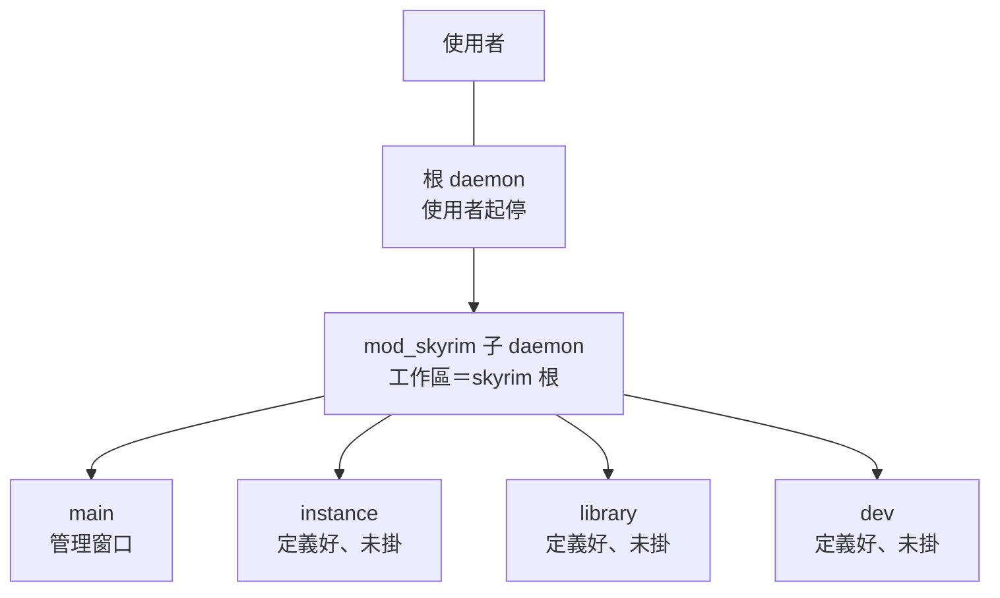

# aos 樹裡的 skyrim 隊：怎麼排、聽誰的

← [WORKFLOWS](../WORKFLOWS.md)｜在 aos 樹裡跑的 skyrim agent（`mod_skyrim` 子 daemon 上的 `main` 與部門座位，以及它們掛的工人）開工先讀這份

**結論**：
- skyrim 的規矩仍以 [AGENTS.md](../../AGENTS.md) 為準。aos 知識庫只教怎麼用樹。
- 誰管哪塊、下一棒給誰、座位叫什麼名字：[wf/org/](../org/README.md)。本頁不重寫。
- 兩邊打架的地方，看本頁第 4 節。
- 找路用 `index_view`，從 skyrim 根開始一層一層往下走。

定案出處：使用者 2026-11-14 13:45 的專區回信（6 題，已 verify），以及當時的頂層 skyrim-agent（舊樹，已不在）當天 05:51 的裁定。

經驗、已知毛病與繞法：[wf/lessons/aos-tree-onboarding-and-leading.md](../lessons/aos-tree-onboarding-and-leading.md)。

## 1. 樹長怎樣、怎麼命名

- **座位與名字**：四個部門的座位、agent 短名、在哪台 daemon，只寫在 [wf/org/README.md](../org/README.md) 的座位表（使用者 2026-11-23，D13）。到 50 個 agent 以上再考慮分 daemon。
- **定義**：部門主管用 [agentctl/aos/defs/](../../agentctl/aos/defs/README.md) 的 `seat-*`。`main` 跑 stock `eca-claude`。夾裡其他 `sk-*`、`skyrim-top` 是舊樹留下的，未整修前不掛。
- **工人** `<上游名>-<角色>-<MMDD><序>`：名字不重用（同名會接上舊對話），做完由上游 rm。
- **工人工作區**：照 [wf/org/CHOICES.md](../org/CHOICES.md) 第 7 題三分法。舊的 `tmp/aos/<名>/` 不再新增。
- **gate**：現在沒有。`main` 沒開 `kernel_gate`，掛 agent 不帶 `AOS_KERNEL`。舊的 [GATE.md](../../agentctl/aos/defs/GATE.md) 已標失效。

**工人用什麼**：Claude 系（Opus／Sonnet）或 fsm gpt（`agent-fsm` 範本接 llm kernel 的 GPT 端點，掛法在 `agentctl/aos/fsm-gpt/`）；codex 2026-11-24 退役，不再派（D20，原話見 [user.md](common/user.md)）。

## 2. 起樹與收樹

- **樹本身**（根 daemon、`mod_skyrim`、`main`）由使用者起停，agent 不動。
- **部門主管**：有工作才掛，沒事 sleep（使用者 2026-11-23，D12）。掛要使用者同意。指令與 sleep／stop 的判準在 [RUNBOOK-seats](../../agentctl/aos/RUNBOOK-seats.md)。

**收工**，由內往外：
1. 工人做完就 rm。
2. 部門主管寫完 REPORT、commit 自己的 submodule 後回報 DONE。
3. `main` 對主管 `stop`。不 rm，保留對話紀錄給下一場接。
4. `main` 派書記短工跑 wrap，pin 由內往外：`instance/profiles` → `instance` → 母 repo。
5. push 由 `main` 統一做，家裡每晚 23:00（使用者 2026-11-24，D25）、公司 WSL 每天 16:50（使用者 2026-11-25，D32）；各座位、工人只 commit。

## 3. aos 活樹硬規則裡適用 skyrim 的四條

出處：`~/repo/aos/wf/workflows/dispatch/aos-teams/06-公司WSL活樹與任務書硬規則.md`「任務書必貼的硬規則」。

- **第 1 條**（原文）：「活樹不碰：不寫 ~/aos-home 底下任何檔、不對它的 daemon 與 agent 下任何指令、不寄信進去。」
  - skyrim 隊本身就在活樹裡，所以讀法是：
    - 不寫 `~/aos-home`、`~/.aos` 底下任何檔。
    - 只用 aos 工具管自己，和自己掛的 agent。
    - 只寄信給上游和自己的下屬。
- **第 4 條**（原文）：「收行程只准兩種：……kill 起的時候自己記下的 pid……禁止 pkill、killall、`kill $(pgrep …)` 與任何按名字或命令列字串收行程的寫法。」
- **第 7 條**（原文）：「一律不 `git add -A`、不 `git add .`；commit 前 `git diff -- <那些檔>` 確認裡面只有自己寫的字。」
  - skyrim 的做法：`git commit -F <訊息檔> -- <逐一點名的檔>`，pin 由內往外。
  - 不用 commit-request，那是 aos repo 的工具。
- **第 8 條**（原文）：「叫真模型測試時只給它真的小工作；不編理由、不繞它講明的限制。」

skyrim 隊另加兩條（當時的頂層 skyrim-agent 2026-11-14 定）：
- **不寫整份環境**：不把整份環境變數寫進檔、印進 log 或放進信（`env`、`printenv`、`/proc/*/environ` 都算）；要看只列變數名或 `AOS_*`。
- **暫存也不刪**：暫存檔、暫存夾一律不刪；要重來就換新夾名。

## 4. 打架點聽誰的

| 打架點 | 定案 | 出處 |
|---|---|---|
| 模型 | opus 主導、sonnet 做事；fsm gpt 普通工作建議 sol，量大呆板看難易度、簡單的交 terra；gpt 不做設計決策 | 專區 q5；D29 |
| 記憶 | 自動記憶停止新增（定義已關）；教訓以 [wf/lessons/](../lessons/) 為準，偏好寫 [user.md](common/user.md)；舊記憶夾只備查 | 專區 q2 |
| 刪檔 | 使用者在對話裡當場說了才刪 | 設計 2.2、D5 |
| 授權 | 專區回信只認普通工作；push 每晚 23:00 統一；刪檔、instance、DB、開遊戲仍要當場說 | 專區 q3；D25 |
| sol 槽 | 全樹同時最多 1 隻 | 專區 q5 |

模型列的舊說法：專區 q5 原寫「sol 只做蒐集與量大呆板」，使用者 2026-11-24 改成上表（D29，原話見 [user.md](common/user.md) 2026-11-24 第二批段）。

- **記憶細節**：定義的 `cli.json` 帶 `autoMemoryEnabled: false`；教訓用 `index_view` 找。舊夾（`~/.claude/projects/` 底下 skyrim 根那一夾的 `memory/`）不寫不改，刪原檔另外問。
- **保留期清理**：hygiene 出清單 → 寄專區通知（附清單）→ 使用者當場說 → 頂層派短工刪。
- **授權**對應 [AGENTS](../../AGENTS.md) 鐵律 2 的「授權來源」；改寫使用者規範不派 sonnet。

- **問使用者**：寄使用者專區（全景頁），每封最多 7 題；預設由管理窗口寄，部門的題以 `NEEDS-USER` 交窗口。例外：申請准了的那一件、使用者直接寄給主管的信；管理部門主管（就是 `main`）平常可寄。使用者 2026-11-23，D18、D19；細節見 [letters](../org/letters.md)「對使用者的通道」。agent-fsm 沒有 `user_send`，題目交給自己的主管。
- **WAIT_USER**：只把「要他裁的」搬去專區；要實機驗的，留在 [WAIT_USER.md](../../WAIT_USER.md)。

## 5. aos 使用者偏好裡適用的三格

出處：`~/repo/aos/wf/workflows/common/user.md`。

- **回覆風格**（第 14 行）：「先結論、短、**大白話**……問「要不要」時附**可執行判準**（門檻數字）與後果。……**問他的題目寄進使用者專區（`aos-user send --kind decide`），會出現在全景頁上**」。
- **問題寄專區**（同一行）：「問我的問題你直接放全景網頁，我現在大多在看那邊」（11-14 午）。
- **需求不清先發想**（`user/03-討論紀錄與規劃.md` 第 36 行起）：「需求還不清楚時，不急著出實作計劃、架構、待裁題、門檻數字、階段；先發散（點子清單＋可丟棄的小實驗），等需求在使用中浮出來再規劃。」

## 6. 信箱、鎖、gate

- **信箱**：md 信箱已凍結，見 [agentctl/inbox/FROZEN.md](../../agentctl/inbox/FROZEN.md)。樹外的 session 要寄信進樹，用 `aos-post send` 寄到該部門主管的 mailbox。
- **遊戲／桌面鎖**：照舊用 agentctl 的 [lock.sh](../../agentctl/tools/lock.sh)。遊戲鎖向 `instance` 借，它沒掛就向 `main`；桌面鎖向 `main` 要；回信點名你才取（使用者 2026-11-23，D4；細節見 [agentctl/docs/resource-locks/aos-tree.md](../../agentctl/docs/resource-locks/aos-tree.md)）。不用 aos-lock（實驗見 [lock-exp/](../../agentctl/handoffs/home-2026-11-14/lock-exp/)）。
- **gate**：現在沒有（見第 1 節）。舊的處理程式 [agentctl/aos/gate/gate_hold.py](../../agentctl/aos/gate/gate_hold.py) 留著備查。
