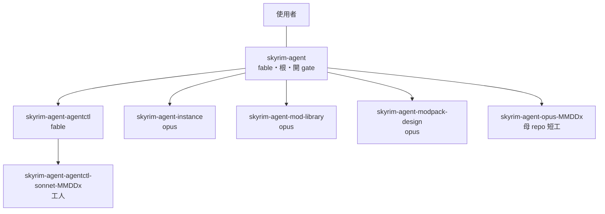

# aos 樹裡的 skyrim 隊：怎麼排、聽誰的

← [WORKFLOWS](../WORKFLOWS.md)｜在 aos 樹裡跑的 agent（daemon 表上名字是 `skyrim-agent` 或 `skyrim-agent-*` 的）開工先讀這份

**結論**：
- skyrim 的規矩仍以 [AGENTS.md](../../AGENTS.md) 為準。aos 知識庫只教怎麼用樹。
- 兩邊打架的地方，看本頁第 4 節。
- 找路用 `index_view`，從 skyrim 根開始一層一層往下走。

定案出處：使用者 2026-11-14 13:45 的專區回信（6 題，已 verify），以及 skyrim-agent 當天 05:51 的裁定。

## 1. 樹長怎樣、怎麼命名

- **頂層** `skyrim-agent`：獨立的根，開 gate；下令、仲裁資源、驗收、跟使用者說話，不親手施工。
- **主導** `skyrim-agent-<區>`：工作區＝該 submodule 根，是它唯一的 commit 者；用到才起。instance 第 1、2 期配 opus。
- **母 repo**：沒有專屬主導，寫入、commit、wrap 由頂層臨時掛的 opus 短工做。
- **工人** `<上游名>-<角色>-<MMDD><序>`：名字不重用（同名會接上舊對話），做完由上游 rm。
- **工人工作區**：四個子 repo（agentctl、instance、mod-library、modpack-design）都用自己已忽略的 `tmp/aos/<名>/`；母 repo 層用 `S/tmp/aos/<名>/`。
- **掛子 agent** 一律帶 `AOS_KERNEL`＝skyrim-agent 的 gate 信箱（單一出處 [agentctl/aos/defs/GATE.md](../../agentctl/aos/defs/GATE.md)）。定義在 [agentctl/aos/defs/](../../agentctl/aos/defs/)。

## 2. 起樹與收樹（用到才起）

一場工作開始時起樹，整場常駐，收工時整棵收掉。沒開工的日子不掛。

**起樹**，由外往內：
1. 起 skyrim-agent。
2. 確認它的 gate 開著。
3. 只起這場要用的主導。
4. 主導照任務書掛工人。

**收樹**，由內往外：
1. 工人做完就 rm。
2. 主導寫完 REPORT、commit 自己的 submodule 後回報 DONE。
3. 頂層對主導 `subagent stop`。不 rm，保留對話紀錄給下一場接。
4. 頂層的 opus 短工跑 wrap，pin 由內往外：`instance/profiles` → `instance` → 母 repo。
5. 問使用者要不要 push。
6. 停掉 skyrim-agent。

## 3. aos 活樹硬規則裡適用 skyrim 的四條

出處：`~/repo/aos/wf/workflows/dispatch/aos-teams/06-公司WSL活樹與任務書硬規則.md`「任務書必貼的硬規則」。

- **第 1 條**（原文）：「活樹不碰：不寫 ~/aos-home 底下任何檔、不對它的 daemon 與 agent 下任何指令、不寄信進去。」
  - skyrim 隊本身就在活樹裡，所以讀法是：
    - 不寫 `~/aos-home`、`~/.aos` 底下任何檔。
    - 只用 aos 工具管自己，和自己掛的 agent。
    - 只寄信給上游和自己的下屬。
- **第 4 條**（原文）：「收行程只准兩種：……kill 起的時候自己記下的 pid……禁止 pkill、killall、`kill $(pgrep …)` 與任何按名字或命令列字串收行程的寫法。」
- **第 7 條**（原文）：「一律不 `git add -A`、不 `git add .`；commit 前 `git diff -- <那些檔>` 確認裡面只有自己寫的字。」
  - skyrim 的做法：`git commit -F <訊息檔> -- <逐一點名的檔>`，pin 由內往外。
  - 不用 commit-request，那是 aos repo 的工具。
- **第 8 條**（原文）：「叫真模型測試時只給它真的小工作；不編理由、不繞它講明的限制。」

## 4. 打架點聽誰的

| 打架點 | 定案 | 出處 |
|---|---|---|
| 模型 | opus 主導、sonnet 做事；sol 只做蒐集與量大呆板；gpt 不做設計決策 | 專區 q5 |
| 記憶 | 自動記憶停止新增（定義已關）；教訓以 [wf/lessons/](../lessons/) 為準，偏好寫 [user.md](common/user.md)；舊記憶夾只備查 | 專區 q2 |
| 刪檔 | 使用者在對話裡當場說了才刪 | 設計 2.2、D5 |
| 授權 | 專區回信只認普通工作與 push；刪檔、instance、DB、開遊戲仍要當場說 | 專區 q3 |
| sol 槽 | 全樹同時最多 1 隻 | 專區 q5 |

- **記憶細節**：定義的 `cli.json` 帶 `autoMemoryEnabled: false`；教訓用 `index_view` 找。舊夾 `~/.claude/projects/-home-lorkhan-repo-moddings-skyrim/memory/` 不寫不改，刪原檔另外問。
- **保留期清理**：hygiene 出清單 → 寄專區通知（附清單）→ 使用者當場說 → 頂層派短工刪。
- **授權**對應 [AGENTS](../../AGENTS.md) 鐵律 2 的「授權來源」；改寫使用者規範不派 sonnet。

- **問使用者**：一律寄使用者專區（全景頁），每封最多 7 題；由 eca（主導或頂層）寄。agent-fsm 沒有 `user_send`，有題目交給主導。
- **WAIT_USER**：只把「要他裁的」搬去專區；要實機驗的，留在 [WAIT_USER.md](../../WAIT_USER.md)。

## 5. aos 使用者偏好裡適用的三格

出處：`~/repo/aos/wf/workflows/common/user.md`。

- **回覆風格**（第 14 行）：「先結論、短、**大白話**……問「要不要」時附**可執行判準**（門檻數字）與後果。……**問他的題目寄進使用者專區（`aos-user send --kind decide`），會出現在全景頁上**」。
- **問題寄專區**（同一行）：「問我的問題你直接放全景網頁，我現在大多在看那邊」（11-14 午）。
- **需求不清先發想**（`user/03-討論紀錄與規劃.md` 第 36 行起）：「需求還不清楚時，不急著出實作計劃、架構、待裁題、門檻數字、階段；先發散（點子清單＋可丟棄的小實驗），等需求在使用中浮出來再規劃。」
