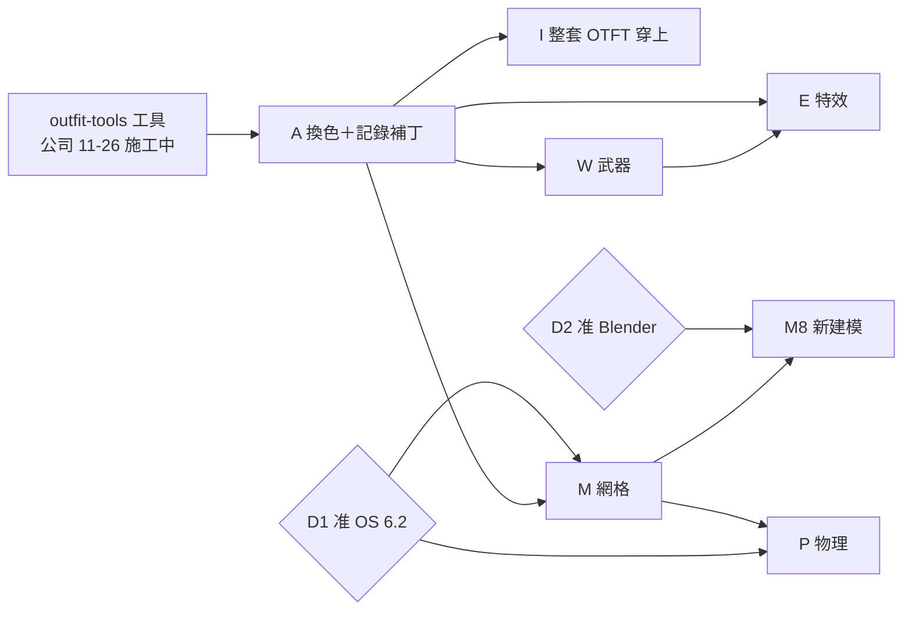

# miku-outfit — 初音整套：換色、武器，以及網格、特效、物理的後續

[plans](../README.md)｜工作流 [racemenu/design-session](../../racemenu/design-session.md)｜場地 [sites](../../../org/sites.md)

Done when: 每個階段都寫明要什麼工具、要使用者授權什麼、家裡和公司各做哪步、閘門與驗收、工作量、先後依賴；每個 task 小到一次做完，而且有驗證方法；待使用者決定的每題附推薦；頂層能直接抄進 BRIEF 派線。

## 目標與依據

使用者 2026-11-26（公司場）：「1.把初音那套做完，包括換色、武器，並規畫更後續的調整模型網格、特效、物理等。2.在公司先不要...。3.可以」。第 2 點回答「Outfit Studio 6.2、Blender、自編 PyNifly 要不要准」：公司先不要，家裡准不准列在決定清單。第 3 點准 outfit-tools 線今天在公司做階段 0 工具。

起點是 11-25 的 Chloe 版初音：臉、雙尾、瀏海已在遊戲裡拍過；五件現成服裝只做了離線試色（[miku-face REPORT](../../../../agentctl/handoffs/home-2026-11-25/miku-face/REPORT.md)）。本計畫只排「服裝、武器以及之後的網格、特效、物理」。臉和髮怎麼套回 Chloe NPC，照該 REPORT 和 [body 說明](../../../../agentctl/handoffs/home-2026-11-25/miku-face/body/README.md)，這裡只列成依賴。

美感不由 agent 判：每個需要取捨的地方都寫成選項＋推薦，由使用者看圖決定。

## 檔案

<!-- wf-nav -->
| 檔 | 內容 |
|---|---|
| [inventory.md](inventory.md) | 現況盤點：五件現成服裝、缺件、試色結果 |
| [recolor.md](recolor.md) | 階段 A 換色與記錄補丁、階段 I 整套穿上 |
| [weapons.md](weapons.md) | 階段 W 武器：蔥、麥克風架的候選 |
| [mesh.md](mesh.md) | 階段 M 網格：無袖、貼身、修穿模、髮飾、領帶 |
| [effects.md](effects.md) | 階段 E 特效：邊光、光源、武器附魔、發光貼圖 |
| [physics.md](physics.md) | 階段 P 物理：雙尾、裙、緞帶（FSMP） |
| [data/](data/) | 資料檔：服裝、換色規格、武器候選、task、決定清單 |

task 全表兩份：階段 A、I、W 在 [tasks-near.json](data/tasks-near.json)（14 列），M、E、P 在 [tasks-later.json](data/tasks-later.json)（20 列）。欄位是編號、階段、要做什麼、在哪做、要什麼授權、怎麼驗、依賴哪些、工作量。

## 階段與依賴

| 階段 | 工作量 | 要使用者授權的 | 公司能做 | 只能在家 |
|---|---|---|---|---|
| A 換色＋記錄 | 約 1.5 天＋實機 1 次 | 裝層、開遊戲 | 規格 JSON、工具 | 真素材、staging、裝、實機 |
| I 整套穿上 | 約 1 天 | 裝層、開遊戲 | 無 | 全部 |
| W 武器 | 約 2–3 天＋實機 1 次 | 裝層、開遊戲；WP2 要下載 | NIF 工具擴充 | 讀原版 NIF、做武器、實機 |
| M 網格 | 約 7–8 天＋實機（新建模另計） | D1；新建模另要 D2 | 規格、交叉量測工具 | 跑 Outfit Studio |
| E 特效 | 約 3 天＋實機 | 裝層、開遊戲 | 記錄寫入器、NIF 旗標工具 | 實機 |
| P 物理 | 約 5–7 天＋實機 | D1 或下載 | 無 | 全部 |

公司場的「做完」只到靜態，沒過實機一律寫「靜態通過，待回家驗」（sites D35）。所有「開遊戲」「裝層」「下載」都要使用者當場說；回家單不算授權。

## 閘門

每個階段進下一關前要過這幾道，細節在各檔：

1. **離線**：工具閘門 exit 0（溢色、alpha、master、FormID、路徑、種族涵蓋）。
2. **對照圖**：同機位的正、背、35°、上身特寫，使用者看過才往下。
3. **裝進 MO2**：`layer_apply` 裝層，profile 三檔只多本層，`check_masters` 沒缺。
4. **實機**：持鎖開遊戲拍照；收場時 profile 稽核綠燈。

## 待使用者決定

17 題在 [decisions.json](data/decisions.json)，每題一句話附推薦，各 task 的依賴欄用 D 編號指過去。最先要答的是：D3–D6（換色怎麼配，家裡出圖後再答也行）、D9／D10（武器做哪個）、D1（家裡准不准 Outfit Studio 6.2，網格與物理全卡它）。

## 建議順序

1. 公司：A1（規格 JSON）、W2（NIF 平移工具）、E1（記錄寫入器），三件都不碰真素材。
2. 家第一場：A2→A3 出圖，使用者答 D3–D6；接 A4→A6 與 W1、W3→W5，一次實機一起驗。
3. 家第二場：I1、I2 掛給 Chloe；E2–E4 記錄層特效。
4. D1 准了以後：M1→M5，再 P0→P4；D2 准了才做 M7、M8。

## 狀態

2026-11-26 出計畫。階段 0 工具由 [outfit-tools](../../../../agentctl/handoffs/home-2026-11-26/outfit-tools/BRIEF.md) 線在公司施工；其餘都還沒動工，等使用者答決定清單。
