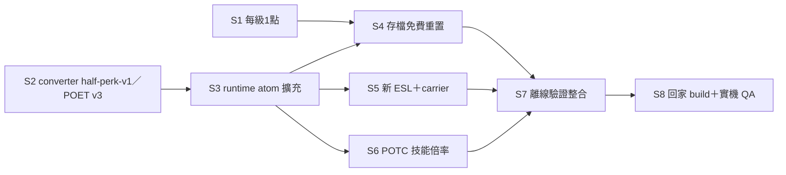

> 封存 2026-11-03，由 poe-skyrim-mapping/phases.md 取代（舊切片含依等級夾值與舊速度上限）

# 施工計畫：切片、依賴與驗收

README｜design

source 正本是 `mod-library/plugins/Path-Of-The-Companions-IndependentSkills-1.2.1-dev-2026-11-03/`，以下簡稱 `PKG`。下文的 path:line 都相對於 `PKG/source`。施工開新候選包（如 `…-1.2.2-dev-<日期>`），依 PKG 的 SOURCE／BUILD 重建，**不改 1.2.1 凍結包**；每片產出 patch 增量，由 S7 合併。

S1 與 S2 可並行；S3 完成後 S5、S6 可並行。S5 的 ESL 記錄本體要在有 houseCARL／Mutagen 的環境做，DLL 接線可先寫。

## S1 點數每級 1 點（S）

- 改 `src/PoeGraph.cpp:43`：`Earned()` 裡的 `*5` 改成具名常數 `kPointsPerLevel=1`，宣告放在 `include/FWM/PoeGraph.h:22` 旁邊。
- 同步改文字：
  - `src/PoeRuntime.cpp:80` 的 log。
  - `config/Translations/FightWithMe_ENGLISH.txt:830`。
  - `paths/config/Translations/IndependentSkills_CHINESE.txt:26`，原文是 "Five points per highest observed level"。
- 同步改測試：`tests/PoeGraphTests.cpp:9,13` 的期望值 5／15 改成 1／3。

Done when: `grep -n '\*5' src/PoeGraph.cpp` 沒有輸出；`run_poe_graph.py` exit 0；兩份翻譯檔都沒有 "Five points"。

## S2 converter：half-perk-v1 與 POET v3（M）

- 改 `tools/convert_poe_graph.py`：
  - `:18-23` 的 PATTERNS 和 `:33-37` 的 `effect()`，換成讀 family-rules.json 與 atoms.json，複本放在 `tools/`，並附來源 sha。
  - `:24` 的 SPECIAL 和 `:66-73` 的 supported 判斷：主圖普通節點與一般鑲嵌座一律 supported；mastery、昇華、proxy、expansion、blighted 照舊不支援。
  - `:76` 的 Effective 描述：改成列出 atom 與實際值。
  - `:95-97`、`:112` 的 profile：改成 `half-perk-v1`。
  - `:108` 的格式：升 POET v3，在 metadata 之後追加 atom 表（kind、AV 路線、每單位值、上限規則）與 caps 表（每級）。
- 節點效果的 amount 存「單位份額」（可以是小數）。
- 改 `tests/run_poe_graph.py:15-19`：期望值改成新的 atom 份額。

Done when: converter 對核准的 data.json 輸出時，report 的 `supported`＝1993、`reachableSupported`＝1993；新 POET 逐節點的 atom 份額與 `poe-design/data/node-effects.json` 的 `units` 欄 diff 為空；`run_poe_graph.py` exit 0。

## S3 unit-v1 擴充為 atom runtime（M–L）

- 改 `include/FWM/PoeGraph.h:9-10`：Kind 擴到 27 種 atom，保留 1–9 的舊值。
- 改 `src/PoeGraph.cpp:33`：Validate 不再要求 `amount==1`，改成要求 0<amount≤1，且每個節點的份額加總為 1±1e-4。
- 改 `src/PoeGraph.cpp:39-40`：header 接受 `half-perk-v1`，並讀 v3 追加的兩張表。
- 改 `src/PoeRuntime.cpp:24-37`：固定 6 個 AV 的陣列，改成依 atom 表彙總；增傷四類先合併各來源再夾上限。上限依 `highestGrantedLevel` 查 caps 表。
- 改 `:42`：沿用 `PoeOverlay::Amount`，flat 帶入的是「單位 × 每單位值」。
- 改 `:47`、`:54`：`i<2` 的資源保比例邏輯擴到 Stamina。
- 改 `:78`：pin 改成新的 profile 和 convertedHash。
- 改 `include/FWM/PoeOverlay.h:5-9`：WeaponSpeedMult 的基值 0 視為 1.0，另寫一個專用函式。
- 改 `src/Menu.cpp:8703`、`:8737`：UI 加「已達上限」狀態，並顯示有效值。
- 測試：`tests/PoeRuntimeTests.cpp`、`run_poe_runtime.py` 用 doubles 驗寫入值與夾值。

Done when: `run_poe_runtime.py` exit 0，且新增的案例都斷言通過：混合節點的 AV 寫入值、L10 增傷被夾到 36.4%、ATKSPD 基值 0→1.0、Stamina 降上限時不致死；故意把上限移除的 compiled-red 版本會被這些測試攔下。

## S4 舊存檔免費重置（S–M）

- 改 `paths/src/Main.cpp:497-501`：POEG v2 是 tag 固定長度 + POEP，改成 POEG v3（u32 tag 長度 + tag + POEP）。v2 讀取保留，專供遷移。
- 改 `paths/src/Main.cpp:467-471`：寫入改成 v3。
- 改 `src/PoeGraph.cpp:64-70`：`DecodeRecords` 加參數 `pointsPerLevel`，讀 v2 時用 5，避免舊配點超過 1×L 而被判 malformed。
- 改 `src/PoeRuntime.cpp:20`、`:115-123`：Load 時如果 tag 等於舊的 `unit-v1` tag（`e4ea…67ab`），就保留 `highestGrantedLevel`，清空 allocated、beforeDebug、debug，並設一次性提示「星盤已改版，點數已免費退回」。其他未知 tag 照舊隔離。
- 改 `src/Menu.cpp:8686`：顯示上述提示。

Done when: 新測試涵蓋三種情境並通過：舊 v2＋unit-v1 tag（allocated 是 5L 個）→ 載入後 allocated 為空、高水位保留；未知 tag → 仍然隔離；v3 存讀 5 輪不漂移。`run_poe_graph.py` 與 `run_poe_runtime.py` 都 exit 0。

## S5 新 ESL 記錄（M，記錄本體在家做）

- 新增一個 ESL，暫名 `PathOfTheCompanions_PoeStar.esl`，只放 POTC 自有記錄，不 master 任何整合包 mod。
- 第一版只放 4 個 PERK：CRIT、CRITDMG、STAGGER、BLOCK。每個 PERK 一個 entry point，函式用 `Add AV Mult` 或 `Multiply 1+AV Mult`，讀各自的 carrier AV。
- 預留 MGEF／SPEL FormID 區段給 B 類，本版不建。
- carrier AV 的候選：`FavorsPerDay`、`FavorsPerDayTimer`、`FavorPointsBonus`、`LastFlattered`、`LastBribedIntimidated`。排除條件：整合包內任何 plugin 的 CTDA／MGEF／PERK 都沒有引用。
- DLL：`src/PoeRuntime.cpp` 的 Apply 在 atom>0 時 `AddPerk`、=0 時 `RemovePerk`，FormID 由 `TESDataHandler::LookupForm(localId, esl名)` 取得；ESL 不在就停用這 4 個 atom 並在 UI 註明。

Done when: 以 houseCARL 掃整合包，5 個 carrier 候選的引用結果有留檔，並選定 4 個零引用的 AV；`check_masters.py` 對新 ESL 的 `present=no` 為 0；`esplib header` 顯示 ESL flag 與 4 筆 PERK；DLL 在 ESL 缺席時的停用路徑有測試，且測試通過。

## S6 POTC 技能倍率介面（M）

- 新增 `Abilities` 讀取 SKILL atom 的有效值。
- 套用點：
  - 持續：`include/FWM/Paths.h:708-740` 的常數乘 (1+x)。
  - 半徑：同檔的 `kRainRadius`（`:724`）等常數乘 (1+x)。
  - 冷卻：乘 (1−x)。
  - Skald 演奏：`src/Skald.cpp:1239` 乘 (1+x)。
- 上限是 25%。

Done when: `run_ability_conditions.py` 與 `run_nativecombat_offline.py` exit 0；新案例斷言 SKILL=0 時所有常數不變（回歸），SKILL=25 時持續、半徑 ×1.25，冷卻 ×0.75。

## S7 離線驗證整合（S）

- 擴充 PKG 的 `tools/run_checks.py`，加入 S1–S6 的測試，並以 `poe_design_calc.py` 的結果當 golden，比對 converter 輸出。
- 更新新包的 REPORT、SPEC、CODE_MAP、MANIFEST。

Done when: `run_checks.py` 輸出全綠，結果存成 `evidence/offline.log`；`prepare_source.py` 從 fixed parents 重套後內容一致；新包 MANIFEST 的 sha 全部符合。

## S8 回家 build 與實機 QA（WAIT_USER）

施工完成時，在母 repo `wait-user/home-setup.md` 的「POTC IndependentSkills 1.2.1」節之後新增一節，登記 7 項：

1. matching Windows build／PE／FileVersion，ESL 納入部署 layout（停機、備份、另行授權）。
2. r3 舊存檔的 POEG 免費重置：提示出現、點數＝等級、PATH／UNLM 不變。
3. 四類增傷 AV 對隨從生效；先用 houseCARL 讀原版 Fortify One-handed／Two-handed／Archery／Destruction MGEF 核 primary AV。
4. AR、抗性、回復、減耗、移速、攻速（含 CARP）實測＝UI 有效值。
5. ESL 的 4 個 perk 在隨從身上生效，與 Valhalla Combat、Blade and Blunt 疊乘無異常。
6. SKILL 倍率影響 POTC 技能的持續、半徑、冷卻。
7. 實讀 Experience.ini 與 B&B GMST（poe-balance 裁示題 5）；80% 護甲上限或 XP 曲線被改就重跑 `poe_design_calc.py` 更新上限。

Done when: `wait-user/home-setup.md` 有這一節且 7 項都在；`tools/waituser_count.py --check` 通過。
