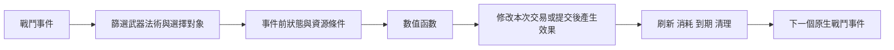

# 觸發條件效果的共用模型

[入口](README.md)｜[循環](loops.md)

同一個規則由「事件＋事件篩選＋對象選擇＋條件＋數值函數＋效果＋生命週期」組成。裝備、目標狀態、資源或數值種類可換參數，無需為三個方向各寫一套專屬職業邏輯。這是設計語義，不是新增DSL執行器的規格。

## 事件與時間

第一版劍盾用例的候選事件取劍命中、盾擊命中、成功格擋與即將承受傷害四類；[八職業總覽](../../../../user/2026-11-04-combat-playstyles.md)另要求施法提交、恢復、召喚原生命中與姿態／範圍事件。那些目前只是共用模型的必要擴充，沒有被這四類涵蓋或證明可行。劍命中包含普通或重擊的明確標籤；盾擊是獨立類型，不能同時冒充普通劍擊。成功格擋要求引擎確認blocked，不把舉盾姿勢當成功格擋；一次接觸同時報格擋與傷害時，它們共享交易識別。取消、未命中與被完全拒絕的接觸不生成本案劍命中事件。這些事件如何取得仍待技術驗證。

事件開始先取唯讀快照：攻擊者、受擊者、武器／法術類型、敵友關係、裝備、當前與最大資源、既有狀態。命中後新給的標記不能被同一次命中拿來增傷或消耗。修改本次傷害必須在傷害提交前使用早已存在的狀態；提交後只可給後續事件buff、debuff或治療，不回頭改已結算傷害。

同一筆格擋不能先產生防禦準備，再立刻把它花在該次格擋的剩餘傷害。本案防禦準備明確從下一筆合資格交易才可用。取快照後付款與效果提交視為一個設計交易；目標失效或付款不足都不消耗狀態、不給部分收益。資源究竟在引擎哪個時點扣除須另驗，不能把設計交易說成現有hook已支持。

## 對象與條件

每條規則顯式綁定actor、event target與effect recipient。敵人依本次事件的actor相對關係判斷，不用固定Player當基準。友軍可含隊友／受控召喚物；owner或同隊不自動等於能接受所有治療，死亡、敵對、不可作用或距離外者排除。支援規則由打敵人或格擋啟動，不要求砍隊友。

條件可以AND／OR組合，例「劍＋盾」「目標持有本人給的破綻」「當前SP≥付款額」「HP_current／HP_max低於參數門檻」。負重、抗性、剩餘MP等也能作輸入候選，但必須標記原始／有效、單位及取值時點；本輪不擴出更多玩法。

## 可讀值的型別

HP／MP／SP屬resource，可讀current、max、missing及比例，也可明確支付或恢復。抗性屬attribute，負重屬load（carried／capacity），皆可讀值與比較；能讀抗性或負重不代表能把它當MP扣款。若日後要降低抗性作代價，必須另定attribute modifier效果，不能偷走resource付款介面。比例必須標出分母，未知或非正的分母使該條件不可判真。

threshold是布林條件，例如SP≥C、HP比例≤H_low；「越多越強／越少越強」是連續值函數，例如k(n)×SP比例。兩者分開：通過門檻不代表增幅固定，值函數算出正值也不能跳過付款條件。

## 值函數與數值界線

基礎值、比例與事件次數不可混單位。點數投入n可表示待校準份數，但本輪未選哪些節點供份。例有條件增傷為baseline_damage × bonus(n, SP_current/SP_max)；治療為heal(n, recipient_missing_HP)，成本是單獨的SP或MP函數，並非附贈免費效果。

比例資源與絕對資源是兩個不同模型：滿耐力傾向比例模型，堆高耐力仍能放大收益傾向絕對模型。兩者都列為待選，不能暗自把「越多越強」變成來源Skull Rattler的同一公式。最大資源≤0或讀值未知時該條不生效，不用除零或補猜測值。

防禦若用倍率，候選函數為incoming_damage／(1＋guard_value)，要求guard_value≥0；它隨數值成長但保持正值，沒有另設cap。這是未定函數提案，不能直接替換既定BLOCK atom或取消既定無上限裁示。新效果的持續／CD／份數與堆疊仍全部待校準。

## 狀態生命週期

破綻鍵是owner＋target＋rule，防禦準備鍵是owner＋rule，護援鍵是giver＋recipient＋rule。不同角色不借用或消耗別人的標記；同來源重上是刷新期限，不累加強度／次數，是待選的狀態行為，並非暗加所有atom的數值上限。若改可疊層，必須另定層數單位、消耗與跨來源合併，不自行補固定上限。

狀態在expire_at到期；t等於expire_at即視為失效。建議預設：owner／giver卸下劍或盾、死亡或離戰時，清自己的暫態及自己送出的護援；recipient死亡、離場或變成非法友方目標時，只清該recipient收到的護援。recipient不需持劍盾，單純卸裝不清護援。存讀亦不保存這批短暫狀態，避免跨場免費帶buff；這些均為提案生命週期，可改成外送護援維持到自然到期。由他人給的護援只移除該giver的實例。

CD若啟用，鍵為owner＋rule，付款成功且效果提交才開始，時長是未定參數。觸發消耗的狀態在成功提交後移除，失敗不吞；同一event_id每條rule只提交一次。合成治療／增傷本身帶origin標籤，不再當原生劍擊、盾擊或格擋來源，不建立自動回饋鏈。多giver護援同時存在時本案先提案只用最早到期的一份，其他保留；合併方式仍需使用者選，不視為已定疊加上限。

## 多條規則同時符合

同一盾擊同時符合A1與D2時，先用同一事件快照算全部額外SP成本，足額才一併付款與提交；不足則兩者附加效果皆不提交，原生盾擊仍正常。這是建議預設，便於同時評估兩路的真正總代價；替換選項是由玩家事前設定規則優先權、足額的先提交，但這會新增配置需求，本輪不採。它不是新增CD或上限。

D1與S3同時保護同一人時，建議預設先套原生防護後，再將兩份規則各自的倍率相乘，並各消耗一份；多giver護援則仍只選最早到期的一份。替換選項是僅用較強的一份並保留另一份，會降低混搭的本次收益但延長保護。這些是不同來源的結算提案，仍需使用者過目，不能先當既定防禦公式。即使倍率相乘，仍須以一次最終傷害提交決定是否一起消耗，不能重入讀到已刪狀態。
