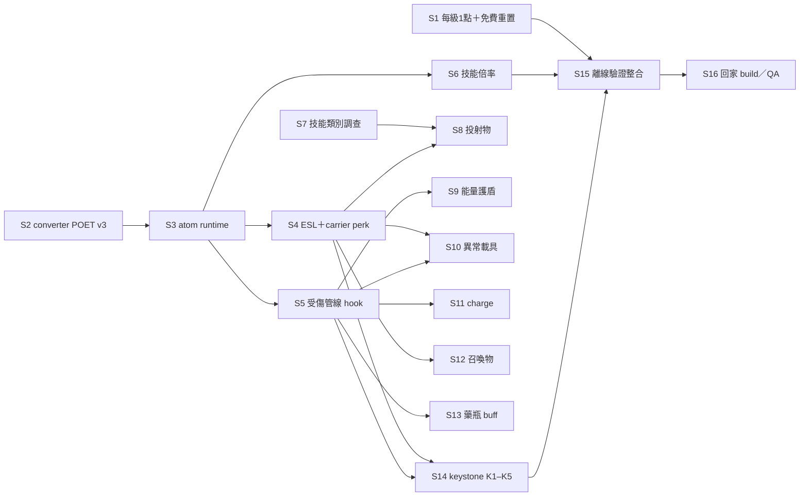

# 施工計畫：切片、依賴與驗收

[README](README.md)｜[decisions](decisions.md)｜[design](design.md)｜[mechanics](mechanics.md)｜[keystones](keystones.md)

source 正本是 `mod-library/plugins/Path-Of-The-Companions-IndependentSkills-1.2.1-dev-2026-11-03/`，以下簡稱 `PKG`。path:line 都相對於 `PKG/source`，行號是 1.2.1 包的。施工開新候選包（如 `…-1.2.2-dev-<日期>`），依 PKG 的 SOURCE／BUILD 重建，**不改 1.2.1 凍結包**；每片產出 patch 增量，由 S15 合併。

## 共通規則

- **不設上限**：舊計畫的依等級夾值、caps 表、UI「已達上限」一律不做。速度 30%／50%／單點 5% 只在 converter 的離線設計檢查擋。
- **派線**：「普通線」派 Opus（C++／Python 施工、調查）；「雜活線」派 Sonnet（文字同步、登記）；「家中」是需要 Windows build、Mutagen／houseCARL 寫記錄或實機的工作。開工的線先讀適用的 `wf/` 規矩。
- 每片的 `Done when:` 只寫可觀察條件；測試一律在 worktree 或隔離目錄跑，不在主工作樹 build。

## 分波

- **第一波（核心星盤）**：S1–S6，加上 S7 調查，以 S15、S16 收尾。完成後星盤全圖可買、數值生效、舊存檔免費重置。
- **第二波起（機制與 keystone）**：S8–S14，每個機制與它的 keystone 段一起出包，每包都再跑一次 S15、S16。

S1、S2、S7 可並行；S3 完成後 S4、S5、S6 可並行。S14 的 K2–K5 各自再等 S9–S12（見 [keystones](keystones.md#施工分批)）。

## 切片索引

<!-- wf-nav -->
| 切片 | 內容 | 依賴 | 派給 |
|---|---|---|---|
| [S1](phases-core.md#s1-每級-1-點舊存檔免費重置) | 每級 1 點＋舊存檔免費重置（同步上線） | — | 普通線 |
| [S2](phases-core.md#s2-converterpoet-v3-與每份數值) | converter：1／3／5 份、每份值、設計檢查 | — | 普通線 |
| [S3](phases-core.md#s3-unit-v1-擴充為-atom-runtime) | unit-v1 擴充為 27 atom、不夾值 | S2 | 普通線 |
| [S4](phases-core.md#s4-新-eslcarrier-perk) | 新 ESL＋4 個 carrier perk | S3 | 普通線＋家中 |
| [S5](phases-core.md#s5-受傷管線與施法扣耗-hook) | 受傷管線與施法扣耗 hook | S3 | 普通線 |
| [S6](phases-core.md#s6-potc-技能倍率) | POTC 技能倍率（SKILL） | S3 | 普通線 |
| [S7](phases-core.md#s7-技能類別調查) | 技能類別調查 | — | 普通線（調查） |
| [S8–S13](phases-mechanics.md) | 投射物、能量護盾、異常、charge、召喚物、藥瓶 | 見檔內 | 普通線 |
| [S14](phases-mechanics.md#s14-keystone-第一批分-5-段) | keystone 第一批 K1–K5 | S4、S5、S9–S12 | 普通線 |
| [S15](#s15-離線驗證整合) | 離線驗證整合 | 該波各片 | 普通線 |
| [S16](#s16-回家-buildqa-登記-wait_user) | 回家 build／QA 登記 WAIT_USER | S15 | 雜活線登記、使用者執行 |

## S15 離線驗證整合

每一波出包前跑一次。

- 擴充 `PKG/tools/run_checks.py`，納入該波各片的測試，並以 S2 的 golden 比對 converter 輸出。
- 更新新包的 REPORT、SPEC、CODE_MAP、MANIFEST。

Done when: `run_checks.py` 全綠，輸出存成新包的 `evidence/offline.log`；`prepare_source.py` 從 fixed parents 重套後內容一致；新包 MANIFEST 的 sha 全部符合。

## S16 回家 build／QA 登記 WAIT_USER

S15 全綠後，在母 repo `wait-user/home-setup.md` 的「POTC IndependentSkills 1.2.1」節之後新增一節，第一波登記 8 項：

1. matching Windows build／PE／FileVersion，ESL 納入部署 layout（停機、備份、另行授權）。
2. 舊存檔的 POEG 免費重置：提示出現、點數＝等級、PATH／UNLM 不變。
3. 四類增傷 AV 對隨從生效；先用 houseCARL 讀原版 Fortify One-handed／Two-handed／Archery／Destruction MGEF 核 primary AV。
4. AR、抗性、回復、減耗、移速、攻速（含 CARP）實測＝UI 有效值。
5. ESL 的 4 個 perk 在隨從身上生效，與 Valhalla Combat、Blade and Blunt 疊乘無異常。
6. SKILL 倍率影響 POTC 技能的持續、半徑、冷卻。
7. 玩家端星盤疊加原版 perk 生效，L50 約原版 ×2 屬預期。
8. 實讀 Experience.ini 與 B&B GMST；護甲 80% 上限或 XP 曲線被改，就重跑 poe-calib 的校準。

第二波起每包另列該包機制的實機項。

Done when: `wait-user/home-setup.md` 有這一節且項目數與上面相同；hub 計數已同步；`tools/waituser_count.py --check` 通過。
