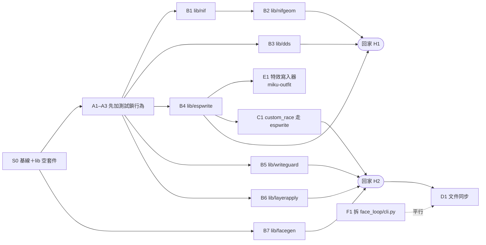

# tools-lib-refactor — 把 agentctl/tools 的 NIF、DDS、ESP 寫入等重複收進 tools/lib/

[plans](../README.md)｜工作流 [refactor](../../refactor/README.md)（搬移看 [moving-things](../../refactor/moving-things.md)）｜場地 [sites](../../../org/sites.md)

Done when: 每處重複都列出檔、函式、行數、誰 import、測試在哪、行為差異；每一步都寫明先加哪些測試、搬什麼、公司驗到哪、回家驗哪幾條黃金回歸、怎麼單獨 revert；待使用者決定的每題附推薦；頂層能直接抄進 BRIEF 派線。

## 目標與依據

頂層 2026-11-26（公司場）向使用者提：程式的問題在重複，不在檔案長度；建議收成 `tools/lib/`（nif、dds、espwrite），先盤點、寫計畫，使用者看過再動手。使用者答「可以，去吧」「對，都做」。

本計畫只排「行為不變的收攏」與大檔怎麼拆。會改行為的（白名單變嚴、ESP 位元組改寫法）都列在待決題目，不混進重構步驟（[AGENTS](../../../../AGENTS.md) 鐵律 1）。

## 本輪範圍（使用者 2026-11-26「都按照推薦。」）

頂層提的精簡版：只做 S0、A2、A3、B1、B3、B4、B5、D1；A1、B2、B6、B7、C1、C2、F1 本輪不做（收益小、沒有黃金可驗，或要開遊戲驗）。各題答案在 [decisions.json](data/decisions.json) 的 `answer` 欄。

## 盤點結論（細目在 [inventory.json](data/inventory.json)，27 列）

實際讀程式後，有三處跟原先的說法不同：

- **DDS 沒有自己寫的解碼器。** 四處解像素都交給 Pillow。真正重複的是 header 解析三份（`npc_face/dds.read_dds`、`outfit/dds.describe`、`jslot_render` 的 DXT1 嗅探），加上 Pillow 包裝兩份（`head_render.load_image` 會縮圖、`outfit.read_image` 不縮且包例外）。全區唯一的 DDS 寫出是 `outfit/dds.write_rgba`。
- **ESP 新寫其實已經大致共用。** `npc_face/espwrite.PluginWriter` 已有五家在用（jslot2npc、trigger、outfit、racetest、nomouse_loop）。另起一套的只有 `custom_race/esp.py`，它寫出的位元組跟 PluginWriter 不同：HEDR 記錄數、排序、編碼、超長子記錄四處（見 Q5）。
- **movesets 沒有 ESP 寫入器。** `movesets/espdb.py` 是唯讀的，跟 esplib 重複。另外兩份「改寫既有 plugin」的程式是 `esp_reforward_tree.py` 與 `transplant_lib/plugin.py`。

NIF 跟原說法一致：`npc_face/nifio.py` 是事實上的共用庫，七支工具在用。另有三份自帶的 header walk。第一份是 `head_render/geom.py` 的幾何層，被 facegen_sculpt 與 outfit 用私有名（底線開頭）耦合。第二份是 `transplant_lib/nif.py`，有自己的貼圖改寫。第三份是 `custom_race/verify.nif_shape_names`，它收 BS 83 的檔，nifio 會拒。

另外看到三組小重複：寫入白名單三份半（outfit、custom_race、racetest，加上 npc_face 的黑名單），layer_apply manifest 草稿四份，FaceGen 路徑樣板四份。FormKey 解析有五種接受範圍，那是各工具的契約，不統一；大小寫不敏感找檔有五份、語意不同，不收。instance/tools、母 repo tools、mod-library 的同類讀取器都在別的 repo，不收。

## 檔案

<!-- wf-nav -->
| 檔 | 內容 |
|---|---|
| [design.md](design.md) | 目標結構、每步通則、舊路徑怎麼留、驗證方法、風險 |
| [data/inventory.json](data/inventory.json) | 重複盤點（NIF、DDS、ESP、白名單、FormKey、manifest、路徑） |
| [data/steps.json](data/steps.json) | 分步（16 步）：做什麼、先鎖什麼、公司驗、回家驗、工作量、依賴、revert |
| [data/home-regress.json](data/home-regress.json) | 回家黃金回歸 14 條，分 H1／H2 兩批，附來源回家單 |
| [data/big-files.json](data/big-files.json) | 600 行以上與 300–600 行的檔：拆不拆、怎麼拆 |
| [data/decisions.json](data/decisions.json) | 待使用者決定 10 題（Q1–Q10），每題附推薦 |

## 先後順序

E1（[miku-outfit 特效](../miku-outfit/effects.md)的記錄寫入器）只要等 B4，不用等 C1。B4 是把 espwrite 原封搬家加別名，約半天就能完成。miku-outfit 的 W2（NIF 平移工具）同理，建在 B1 之後的 `lib/nif` 上。

## 工作量

| 段 | 公司 | 回家 |
|---|---|---|
| S0＋A1–A3 | 約 1.5 天 | 無 |
| B1–B4 | 約 2 天 | H1 一批，約半天 |
| B5–B7、C1 | 約 2.5 天 | H2 一批，約半天 |
| D1、F1 | 約 1 天 | F1 實機一輪（要使用者當場說） |
| C2（可選） | 約 1 天 | 要 houseCARL，先錄黃金 |

合計公司約 7 天（不含 C2），回家兩批各半天。每步都只動 `agentctl/tools`，不碰真 MO2、profile、Data，公司能做到合成測試全綠。

## 待使用者決定

10 題在 [decisions.json](data/decisions.json)：Q1 套件放哪、Q2 舊路徑留不留、Q3 白名單統不統一、Q4 要不要補逐檔 symlink 檢查、Q5 custom_race ESP 位元組、Q6 transplant_lib 收不收、Q7 espdb、Q8 拆哪些大檔、Q9 E1 建在哪、Q10 回家怎麼排。動工前至少要答 Q1、Q2、Q3、Q5；其餘可以邊做邊答。

## 狀態

2026-11-26 出計畫（公司場，tools-refactor-plan 線，只讀程式、沒改程式）。尚未動工，等使用者看過、答待決題。
